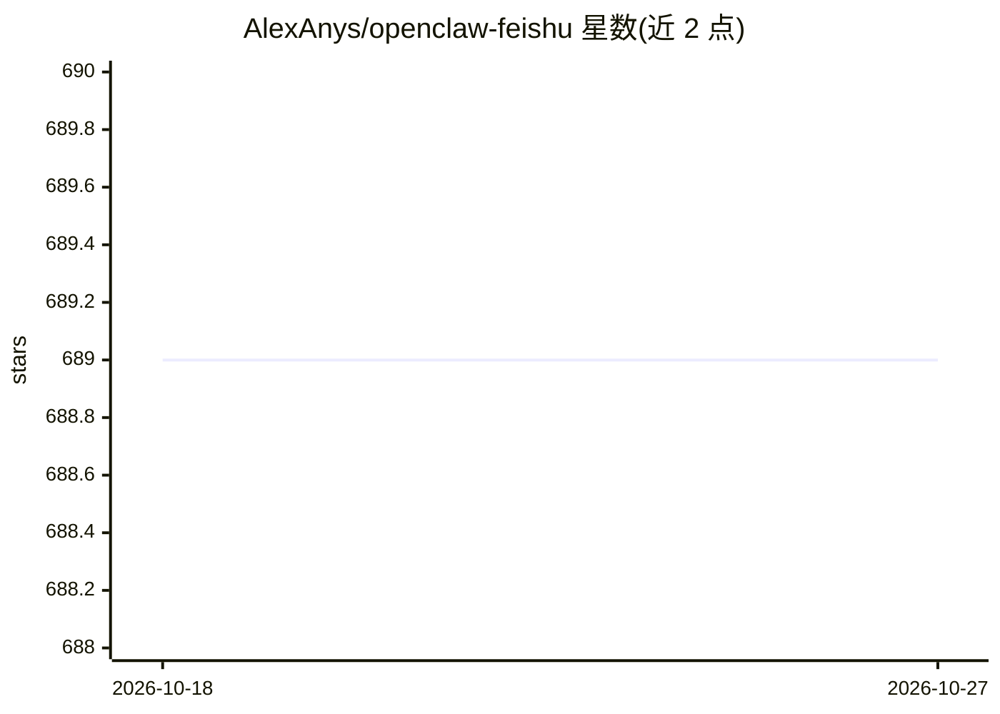

# AlexAnys/openclaw-feishu

⭐ 689 · TypeScript · MIT · 推送 2026-03-30 · [GitHub](https://github.com/AlexAnys/openclaw-feishu) · 个人维护 · 中文 README

**飞书接入 OpenClaw 的配置指南与社区支持仓库**

面向 OpenClaw 用户的飞书/Lark 接入文档仓库：覆盖飞书官方插件、OpenClaw 内置插件、本项目旧插件三条路径的安装迁移教程，含权限批量导入 JSON、事件订阅、WebSocket 长连接与 Lark Webhook 模式（需公网隧道）、多 Agent 路由与访问控制等进阶配置，以及配额耗尽、代理冲突等排查清单。本项目早期开发的社区插件已停止更新，推荐迁移到前两者。

## 筛选速览

| 维度 | 判定 | 备注 |
|---|---|---|
| AI 角色 | `ai-knowledge` | 知识聚合/清单类 |
| 许可风险 | `permissive` | MIT |
| 部署形态 | `None` |  |
| 模型依赖 | — | README 未给出锁定关系 |
| 硬件要求 | — | 无带数字的原话,不猜 |
| 安装摩擦 | `low` | 无编译、无系统依赖或容器化 |
| 成熟度 | — | 结构信号不足 |

## 能力要点

- 三种飞书插件方案的对比表与选择建议
- 飞书国内版 WebSocket 长连接零公网配置全流程
- Lark 国际版 Webhook 模式接入（Cloudflare Tunnel/ngrok/Tailscale Funnel）
- 常见问题排查：API 配额耗尽根因、代理导致 400、duplicate plugin id 等

## 适用场景

- 把 OpenClaw 机器人接入飞书或 Lark 作为聊天入口
- 从旧的社区桥接插件迁移到官方或内置插件
- 排查飞书 API 配额耗尽、断连等运行问题

## 场景标签

`教程课程` · 领域:学习与行业

## 证据(README 行号)

> L3: 飞书 × OpenClaw 保姆级配置指南 & 社区支持
> L28: - **(c) 本项目插件** — 本仓库早期开发的社区飞书插件（已停止更新，推荐迁移到 a 或 b）

## 星数曲线

2026-10-18 689 → 2026-10-27 689（+0）

---
*卡片 v1 · prompt 1.4 · 生成 2026-10-21 · 置信度 high · 依据 README sha `c671456cda9b` · [字段定义](../../DATASET.md)*
