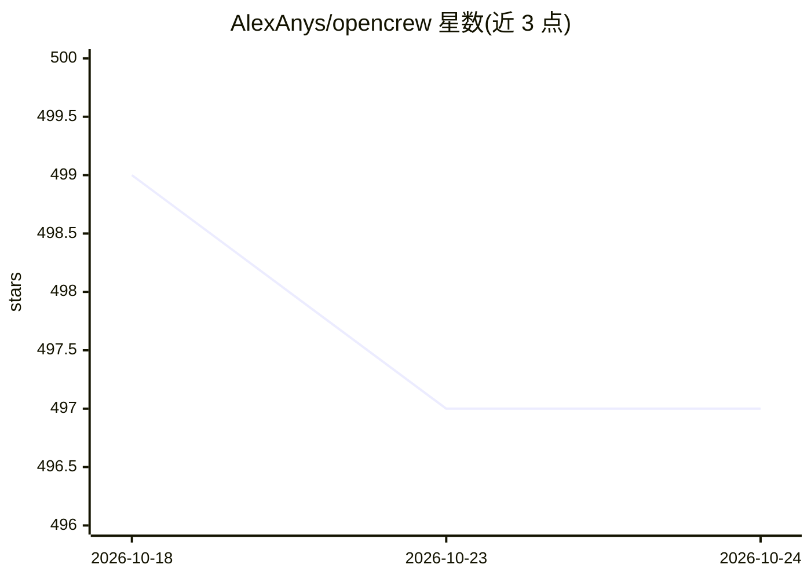

# AlexAnys/opencrew

⭐ 497 · Shell · MIT · 推送 2026-04-05 · [GitHub](https://github.com/AlexAnys/opencrew) · 个人维护 · 中文 README

**把 OpenClaw 组织成多 Agent 团队的配置与协作系统**

基于 OpenClaw 的多智能体组织框架：将多个 Agent 按角色分工（CoS/CTO/Builder/KO/Ops 等），以 Slack/飞书/Discord 的频道作为岗位、Thread 作为任务进行管理。机制包括自主等级 L0-L3、任务分类 QAPS、A2A 委派与讨论两种协作模式、Closeout 三层知识沉淀与 Ops 审计。部署方式为 clone 仓库后由现有 OpenClaw Agent 自动复制配置完成，无需写代码。最小配置 3 个 Agent，模型协作纪律依赖 Prompt 规则而非系统强制。

## 筛选速览

| 维度 | 判定 | 备注 |
|---|---|---|
| AI 角色 | `ai-ecosystem` | LLM/agent 周边工具 |
| 许可风险 | `permissive` | MIT |
| 部署形态 | `None` |  |
| 模型依赖 | — | README 未给出锁定关系 |
| 硬件要求 | — | 无带数字的原话,不猜 |
| 安装摩擦 | `low` | 无编译、无系统依赖或容器化 |
| 成熟度 | `idea` | |

## 能力要点

- 频道=岗位、Thread=任务的 Agent 组织模型，支持 Slack/飞书/Discord
- A2A v2：委派（sessions_send）与讨论（独立 Bot @mention）两种协作模式
- 自主等级 L0-L3 与 QAPS 任务分类规范
- 三层知识沉淀：原始对话→Closeout 结构化总结（约 25x 压缩）→KO 提炼知识

## 适用场景

- 把单个 OpenClaw Agent 拆成多角色团队，避免上下文膨胀
- 通过 Slack 频道管理 AI 团队并追踪各任务进度
- 沉淀团队对话经验为可复用知识并审计 Agent 漂移

## 场景标签

`多智能体` `Agent 框架` · 领域:Agent 开发

## 证据(README 行号)

> L6: > 把你的 OpenClaw 变成一支可管理的 AI 团队——领域专家各司其职，经验自动沉淀。
> L303: 那些是给开发者写代码用的 SDK。OpenCrew 是给决策者管团队用的系统——你通过 Slack 管理 AI 团队，不用写一行代码。它们解决"怎么编排 Agent"，OpenCrew 解决"怎么管理一支 AI 团队"。

## 星数曲线

2026-10-18 499 → 2026-10-24 497（-2）

---
*卡片 v1 · prompt 1.4 · 生成 2026-10-22 · 置信度 high · 依据 README sha `834bcaed5e2d` · [字段定义](../../DATASET.md)*
