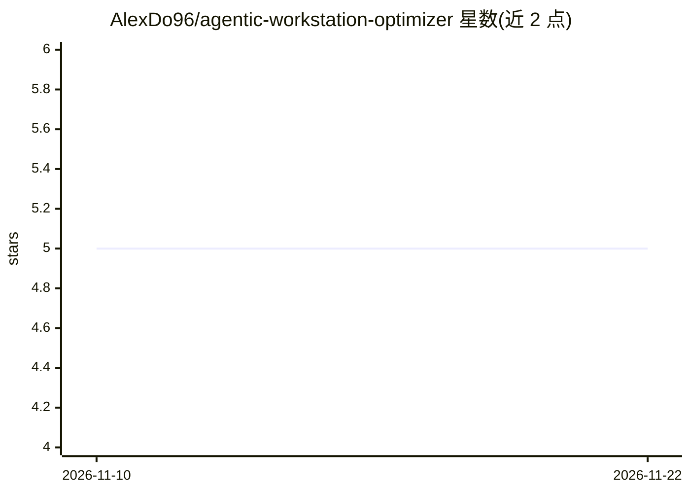

# AlexDo96/agentic-workstation-optimizer

⭐ 5 · PowerShell · MIT · 推送 2026-11-08 · [GitHub](https://github.com/AlexDo96/agentic-workstation-optimizer) · [官网](https://github.com/AlexDo96/agentic-workstation-optimizer#readme) · 个人维护 · 中文 README

**给 Windows 用户和 AI Agent 提供系统/网络/游戏性能调优的 PowerShell 工具包**

一套 PowerShell 脚本与 AI Agent 技能定义，用于诊断并修改 Windows 10/11 工作站的性能配置：电源计划与 CPU 调度、NIC 缓冲与网络节流、NTFS 文件 I/O、临时端口扩容、WSL2 网络以及 Ollama 本地模型参数。改动前自动备份到 JSON 快照并支持一键回滚，提供 All/Work/Gaming 模式区分家用与办公环境。可通过 Claude Code、Cursor 等七种 Agent 调用，也可不依赖 Agent 直接以管理员 PowerShell 运行脚本。

## 筛选速览

| 维度 | 判定 | 备注 |
|---|---|---|
| AI 角色 | `ai-enhanced` | 去掉 AI 部分产品仍成立 |
| 许可风险 | `permissive` | MIT |
| 部署形态 | `desktop` | 安装包/桌面程序 |
| 模型依赖 | local-ok | 支持本地模型 |
| 硬件要求 | — | 无带数字的原话,不猜 |
| 安装摩擦 | `low` | 无编译、无系统依赖或容器化 |
| 成熟度 | — | 结构信号不足 |

## 能力要点

- 修改前自动备份系统设置至 backups/latest-snapshot.json，支持一键回滚
- 覆盖电源调度、NIC 缓冲、NTFS I/O、临时端口、WSL2、Ollama 参数等配置项
- 支持 Claude Code/OpenCode/Antigravity/Cursor/Codex/Windsurf/Copilot 七种 Agent 入口
- 附带诊断脚本可输出 BENCHMARK_REPORT.md 只读报告

## 适用场景

- 家用或游戏 PC 上调低网络延迟、解锁高性能电源计划
- 办公网络下修复 Node.js/Git 的 AI API 调用慢与 SSL 错误
- 并行 E2E/API 测试时扩容临时端口避免端口耗尽
- 本地 Ollama 模型开启 Flash Attention 并清理闲置显存占用

## 场景标签

 · 领域:系统工具/性能优化

## 证据(README 行号)

> L23: `agentic-workstation-optimizer` is a collection of PowerShell scripts and AI Agent skill definitions (compatible wi
> L29: - **Safe for Both Home (`-Mode All`) and Office (`-Mode Work`) PCs:** Automatically backs up all system settings to
> L81: You can run the scripts manually in **PowerShell (Admin)** without an AI agent:

## 星数曲线

2026-11-10 5 → 2026-11-22 5（+0）

---
*卡片 v1 · prompt 1.4 · 生成 2026-11-21 · 置信度 high · 依据 README sha `4d8768ea901c` · [字段定义](../../DATASET.md)*
