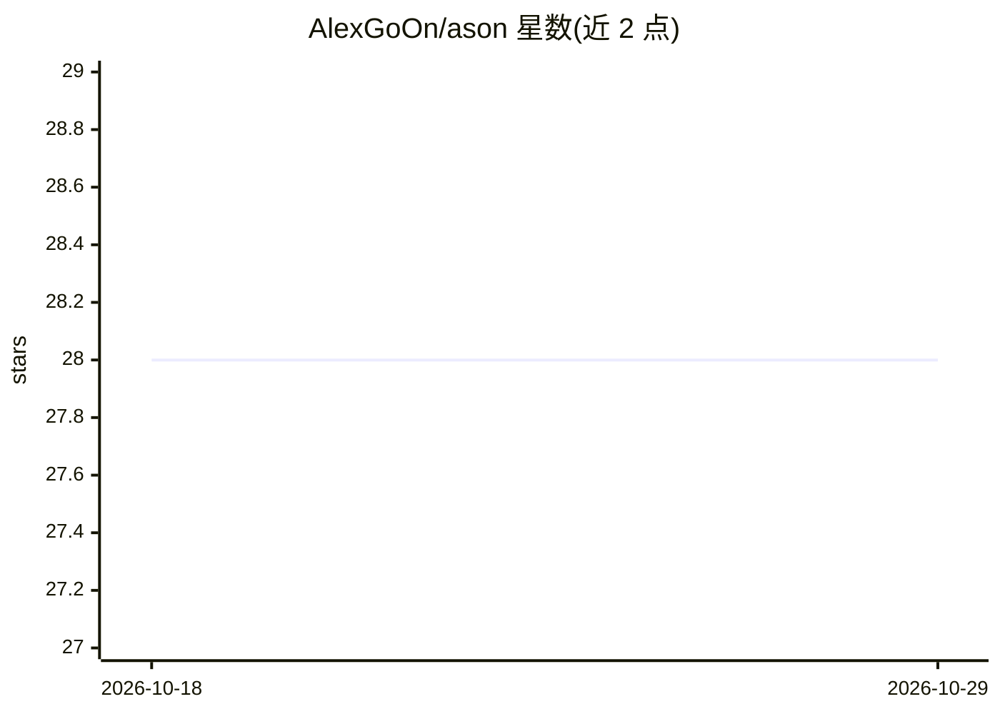

# AlexGoOn/ason

⭐ 28 · C# · MIT · 推送 2026-01-10 · [GitHub](https://github.com/AlexGoOn/ason) · 个人维护

**让 AI agent 通过生成脚本控制 .NET 应用的库**

面向 .NET 开发者的库：应用通过 Operator 暴露方法与领域模型，ASON 的多个内部 agent（Reception/Script/Extractor/Explainer）根据自然语言任务生成完整脚本并经代理调用真实方法，区别于 MCP/tool-calling 的多轮调用方式。脚本可运行在同进程（含静态分析拦截不安全操作）、外部进程、Docker 容器或远程服务器；支持 Semantic Kernel 兼容的多种聊天补全服务（OpenAI/Azure/Gemini/Ollama/Anthropic 等），并可调用 MCP 服务器函数。通过 dotnet 项目模板安装，自称新库、公开 API 可能变更。

## 筛选速览

| 维度 | 判定 | 备注 |
|---|---|---|
| AI 角色 | `ai-ecosystem` | LLM/agent 周边工具 |
| 许可风险 | `permissive` | MIT |
| 部署形态 | `self-host` | docker 或自建部署 |
| 模型依赖 | local-ok | 支持本地模型 |
| 硬件要求 | — | 无带数字的原话,不猜 |
| 安装摩擦 | `low` | 无编译、无系统依赖或容器化 |
| 成熟度 | `idea` | |

## 能力要点

- 自然语言任务→AI 生成完整脚本→单次执行多步操作
- 4 种执行环境：同进程/外部进程/Docker/远程服务器，同进程含静态分析拦截不安全操作
- 多内部 agent 协作：Reception/Script/Extractor/Explainer
- 通过 OperatorBuilder.AddMcp 调用 MCP 服务器函数

## 适用场景

- 在 Blazor/WPF/WinForms/MAUI/Console 应用中加入自然语言驱动的多步数据操作
- 让 AI 从非结构化文本（如邮件）中提取数据并执行业务方法
- 以脚本方式替代多轮 tool-calling 完成批量数据处理任务

## 场景标签

`Agent 框架` · 领域:Agent 开发

## 证据(README 行号)

> L4: **ASON** is a library that enables AI models to generate scripts and execute sequences of functions in your applicat
> L152: - `IChatCompletionService defaultChatCompletion` — A chat completion service used by ASON agents. Supports OpenAI,

## 星数曲线

2026-10-18 28 → 2026-10-29 28（+0）

---
*卡片 v1 · prompt 1.4 · 生成 2026-10-26 · 置信度 mid · 依据 README sha `760030063da6` · [字段定义](../../DATASET.md)*
