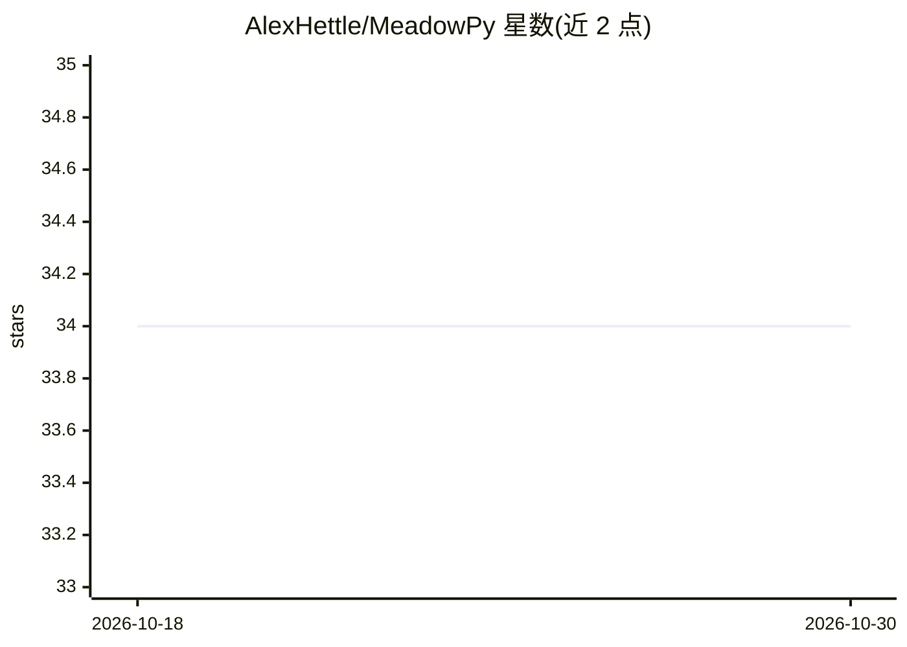

# AlexHettle/MeadowPy

⭐ 34 · Python · 推送 2026-10-29 · [GitHub](https://github.com/AlexHettle/MeadowPy) · 个人维护

**面向初学者的 Python IDE，内置本地 AI 助手与调试器**

基于 PyQt 的 Windows 桌面 Python IDE，面向零基础学习者：提供标签式编辑器、flake8/pylint 实时 lint、逐步调试器（断点/变量监视/调用栈）、集成 REPL 与终端。AI 功能通过 Ollama 在本地运行，包括上下文感知的聊天面板、右键解释/审查代码/生成 docstring、整文件审查与 lint 错误 AI 解释，可选装。另含 100+ 错误模式的英文白话解释、50+ 关键词解释、12 个启动模板与示例库。要求 Windows 10/11 与 Python 3.11+，通过 setup.bat 创建虚拟环境安装，macOS/Linux 未支持。

## 筛选速览

| 维度 | 判定 | 备注 |
|---|---|---|
| AI 角色 | `ai-enhanced` | 去掉 AI 部分产品仍成立 |
| 许可风险 | `none` | — |
| 部署形态 | `desktop` | 安装包/桌面程序 |
| 模型依赖 | local-ok | 支持本地模型 |
| 硬件要求 | — | 无带数字的原话,不猜 |
| 安装摩擦 | `low` | 无编译、无系统依赖或容器化 |
| 成熟度 | — | 结构信号不足 |

## 能力要点

- AI 助手经 Ollama 全本地运行，支持多模型切换与流式输出
- 100+ 常见错误模式翻译为白话英文解释
- 逐步调试器含断点、变量监视、watch 表达式与调用栈查看
- 12 个即用启动模板与分类示例库

## 适用场景

- 零基础学习 Python 时获得易懂的错误解释和引导
- 在本地离线使用 AI 解释代码、审查文件、生成 docstring
- 用调试器逐行观察程序运行与变量变化

## 场景标签

`AI 助手` · 领域:对话与助手

## 证据(README 行号)

> L6: A beginner-friendly Python IDE with built-in AI assistance, a step-through debugger, and everything you need to star
> L28: **AI that stays on your machine.** MeadowPy's AI assistant runs entirely locally via Ollama — no account, no subscr
> L53: - **Ollama** (optional, for AI features) — Download Ollama

## 星数曲线

2026-10-18 34 → 2026-10-30 34（+0）

---
*卡片 v1 · prompt 1.4 · 生成 2026-10-25 · 置信度 high · 依据 README sha `69598c9e2545` · [字段定义](../../DATASET.md)*
