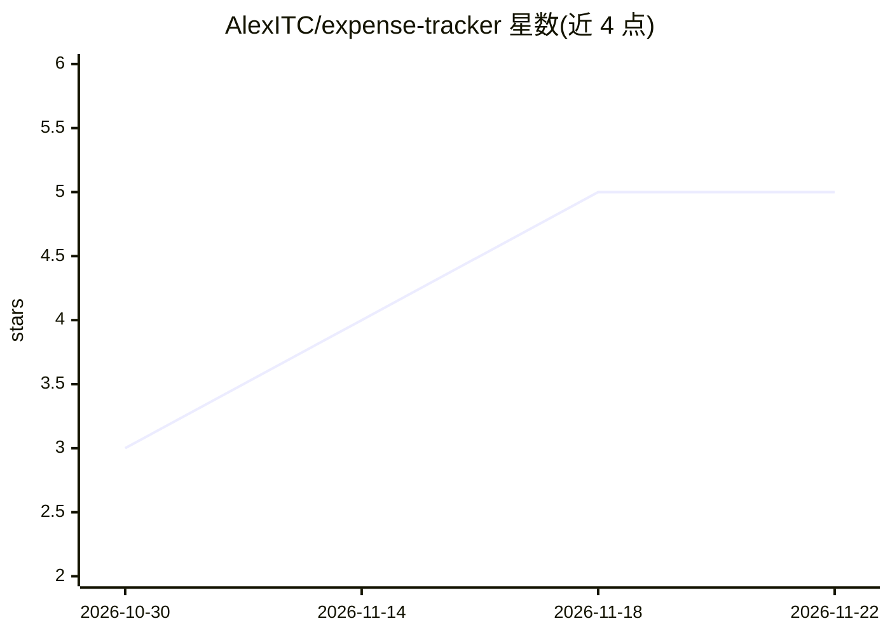

# AlexITC/expense-tracker

⭐ 5 · Scala · MIT · 推送 2026-11-18 · [GitHub](https://github.com/AlexITC/expense-tracker) · [官网](https://alexitc.com/blog/2026-10-16-opensourcing-my-expense-tracker/) · 个人维护

**自托管个人记账应用：收据与银行账单自动转成账本**

自托管应用，上传收据照片或 PDF 银行账单后提取交易、分类并相互对账，生成完整账本。功能含分类别支出、导入规则、AWS Textract 收据 OCR、基于 Amazon Bedrock 的账单提取（含余额链校验）、Telegram bot、供 AI 助手查询数据的 MCP server。AWS 功能默认 mock 模式，无云账号即可本地端到端运行。需 JDK/sbt/Node/PostgreSQL，支持 docker compose。声明处于实验阶段，有频繁破坏性变更。作者声明代码由 AI 生成，本人负责指导与审查。

## 筛选速览

| 维度 | 判定 | 备注 |
|---|---|---|
| AI 角色 | `ai-enhanced` | 去掉 AI 部分产品仍成立 |
| 许可风险 | `permissive` | MIT |
| 部署形态 | `self-host` | docker 或自建部署 |
| 模型依赖 | locked-api |  |
| 硬件要求 | — | 无带数字的原话,不猜 |
| 安装摩擦 | `low` | 无编译、无系统依赖或容器化 |
| 成熟度 | `idea` | |

## 能力要点

- 收据 OCR：Textract 提取金额、日期、商家与明细
- 银行账单 AI 提取并与对账余额链自动核验
- MCP server 允许 AI 助手经 API token 查询数据
- AWS 依赖默认 mock 模式，本地无云账号可运行

## 适用场景

- 拍照/上传收据自动入账，减少手工录入
- 导入 PDF 银行账单并与支出自动核对防重复计数
- 通过 Telegram bot 随时提交支出
- 全部数据保存在自托管实例上

## 场景标签

`OCR` · 领域:感知与多模态

## 证据(README 行号)

> L22: AI is used in two places: building the app, and features inside it such as receipt OCR and bank
> L41: - **Bank-statement import with AI extraction** — upload a PDF statement; the app extracts every
> L50: AWS-backed features (Textract, Bedrock, Bedrock Data Automation, S3) default to **mock** mode, so the

## 星数曲线

2026-10-30 3 → 2026-11-22 5（+2）

---
*卡片 v1 · prompt 1.4 · 生成 2026-11-21 · 置信度 high · 依据 README sha `44af328115c9` · [字段定义](../../DATASET.md)*
