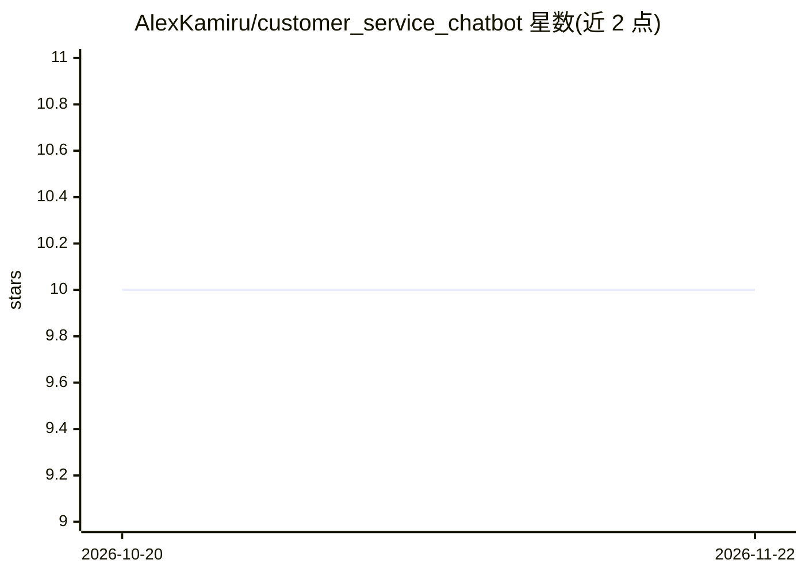

# AlexKamiru/customer_service_chatbot

⭐ 10 · Python · 推送 2026-07-14 · [GitHub](https://github.com/AlexKamiru/customer_service_chatbot) · [官网](https://customerservicechabot-fwhobmzfapptekgssnzmg83.streamlit.app) · 个人维护

**面向中小企业的文档问答客服 RAG 机器人**

基于公司文档回答客服问题的 RAG 机器人：启动时读取 data/ 下的 .txt 文件，用 Voyage AI 生成嵌入并写入 FAISS 索引；查询时检索 top-K 相似片段，交由 Groq 托管的 Llama 3.3 70B 生成带内联引用的回答。前端 Streamlit、后端 FastAPI，REST API 提供 /chat、/health、/docs 等端点。前后端解耦部署于 Render 与 Streamlit 云免费层，README 称总托管成本为 $0。新增知识只需放入 txt 文件并重启。

## 筛选速览

| 维度 | 判定 | 备注 |
|---|---|---|
| AI 角色 | `ai-native` | 本体是模型或模型工具 |
| 许可风险 | `none` | — |
| 部署形态 | `library` | 以包/库形式分发 |
| 模型依赖 | locked-api |  |
| 硬件要求 | — | 无带数字的原话,不猜 |
| 安装摩擦 | `low` | 无编译、无系统依赖或容器化 |
| 成熟度 | — | 结构信号不足 |

## 能力要点

- FAISS 检索 + Groq Llama 3.3 70B 生成，回答附文档/章节引用
- REST API（FastAPI）与 Streamlit 聊天界面分离部署
- 部署于免费层：无 GPU、无付费托管，启动时自动重建向量索引
- 更新知识库仅需替换 .txt 文件并重启，无需重新训练

## 适用场景

- 让机器人根据公司政策/产品文档自动回答常见客服问题
- 以低成本为客服系统提供 24/7 自动应答
- 搭建可审计出处的文档问答演示项目

## 场景标签

`聊天机器人` `文档问答` `RAG` · 领域:对话与助手

## 证据(README 行号)

> L35: This chatbot answers customer service questions grounded in your own documents. Instead of relying on a generic LLM
> L54: |Embeddings|Voyage AI (`voyage-3-lite`)|Semantic search|
> L56: |LLM|Groq (`llama-3.3-70b-versatile`)|Answer generation|

## 星数曲线

2026-10-20 10 → 2026-11-22 10（+0）

---
*卡片 v1 · prompt 1.4 · 生成 2026-11-20 · 置信度 high · 依据 README sha `1c67ad0d85bd` · [字段定义](../../DATASET.md)*
