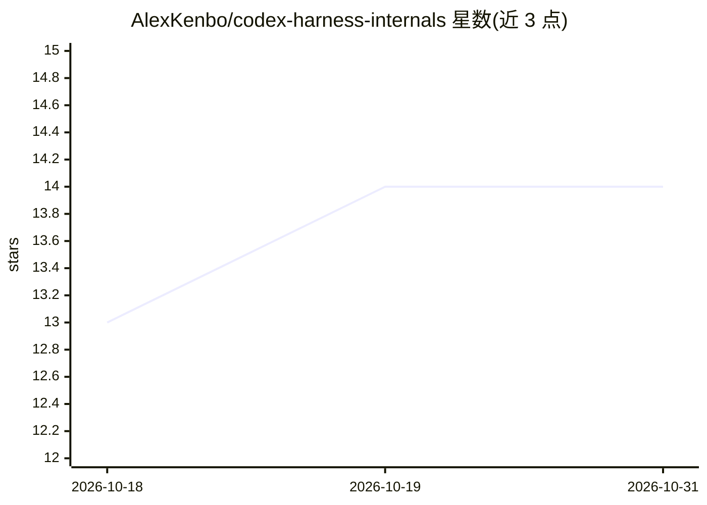

# AlexKenbo/codex-harness-internals

⭐ 14 · 推送 2026-04-20 · [GitHub](https://github.com/AlexKenbo/codex-harness-internals) · 个人维护 · 中文 README

**逆向整理的 OpenAI Codex CLI harness 内部机制规格知识库**

对 OpenAI Codex CLI harness（agent 循环、工具注册、压缩、上下文管理）做逆向工程后整理成的可导航知识库：18 个 SRC 模块覆盖协议、状态、agent 核心、上下文、工具五层，产出 1,028 条规则、588 个结构、325 个用例（约 1,941 个组合）。面向编写 agent 指令/系统提示词的作者和自建 harness 的工程师，列出 5 处指令被静默截断的位置、5 个定义 harness 行为的参数，并对比 Codex 与业界常见做法（如 LangChain/AutoGen）的设计差异。明确排除 sandbox、MCP、auth 等范围。

## 筛选速览

| 维度 | 判定 | 备注 |
|---|---|---|
| AI 角色 | `ai-knowledge` | 知识聚合/清单类 |
| 许可风险 | `none` | — |
| 部署形态 | `library` | 以包/库形式分发 |
| 模型依赖 | — | README 未给出锁定关系 |
| 硬件要求 | — | 无带数字的原话,不猜 |
| 安装摩擦 | `low` | 无编译、无系统依赖或容器化 |
| 成熟度 | — | 结构信号不足 |

## 能力要点

- 18 个模块 × rules/structures/use-cases 三个视角，约 1,941 个组合
- 列出 5 处 harness 静默截断指令的阈值（5000 字节、100 条前缀、20000 token 等）
- 五层指令生命周期与压缩存活规则的说明
- Codex 与业界典型做法的四项设计差异对比

## 适用场景

- 编写 AGENTS.md / 系统提示词时了解规则在最终提示中的位置与存活情况
- 自建 agent 循环时参照 Codex 的 turn 机制、压缩与重试策略
- 排查指令在多轮对话后被'遗忘'的原因

## 场景标签

`知识库管理` · 领域:知识与检索

## 证据(README 行号)

> L5: Reverse-engineered specification of the OpenAI Codex CLI harness — the mechanics of the agent loop, tools registry, 
> L64: |`rules.json`|Invariants, thresholds, formulas, GWT examples (Given / When / Then)|**1 028 rules**|

## 星数曲线

2026-10-18 13 → 2026-10-31 14（+1）

---
*卡片 v1 · prompt 1.4 · 生成 2026-10-31 · 置信度 mid · 依据 README sha `cdaf3fdb312b` · [字段定义](../../DATASET.md)*
