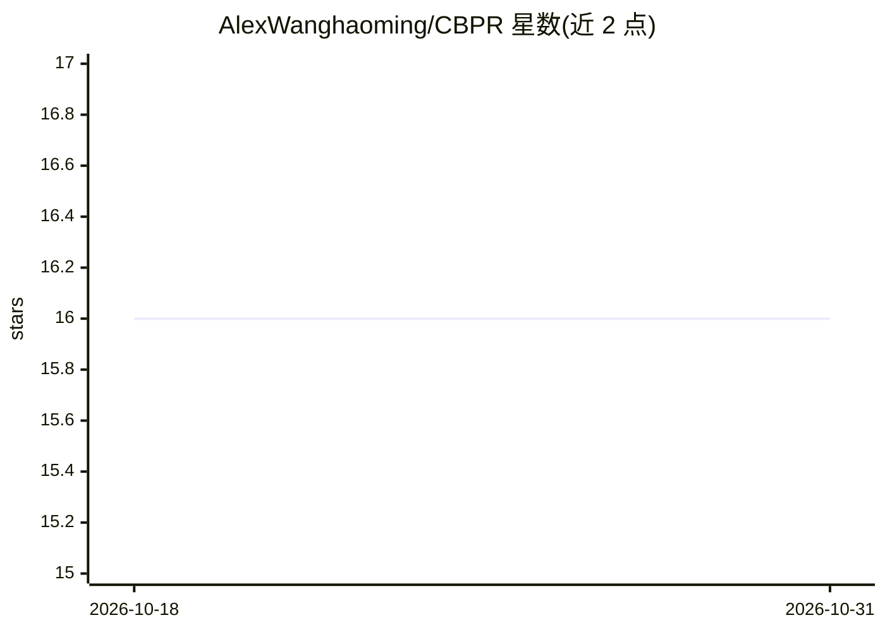

# AlexWanghaoming/CBPR

⭐ 16 · Python · MIT · 推送 2026-09-01 · [GitHub](https://github.com/AlexWanghaoming/CBPR) · 个人维护

**NeurIPS 2024 论文官方代码：CBPR 人机协作强化学习算法**

NeurIPS 2024 论文 Beyond Single Stationary Policies 的官方实现，提出 CBPR（基于 Meta-Task Playing）方法用于 Overcooked 环境的人机协作。所有 agent 基于 PPO 实现，README 提供自博弈（SP）、FCP、BCP 基线与 MTP/CBPR 的训练脚本，以及与切换策略、不同技能水平 agent 协作的评测命令；另提供本地 Web 界面（127.0.0.1:5001）用于人机协作评测。安装依赖 conda 环境（Python 3.8）与 requirements.txt。面向强化学习与人机协作方向的研究人员复现实验。

## 筛选速览

| 维度 | 判定 | 备注 |
|---|---|---|
| AI 角色 | `ai-native` | 本体是模型或模型工具 |
| 许可风险 | `permissive` | MIT |
| 部署形态 | `library` | 以包/库形式分发 |
| 模型依赖 | — | README 未给出锁定关系 |
| 硬件要求 | — | 无带数字的原话,不猜 |
| 安装摩擦 | `low` | 无编译、无系统依赖或容器化 |
| 成熟度 | — | 结构信号不足 |

## 能力要点

- CBPR 基于 Meta-Task Playing (MTP) 构建，全部 agent 基于 PPO 实现
- 提供 SP/FCP/BCP 基线与 MTP 训练脚本
- 支持策略切换与不同技能水平协作的评测实验
- 内置 Overcooked 游戏 Web 界面用于人机评测

## 适用场景

- 复现 NeurIPS 2024 论文的训练与评测实验
- 在 Overcooked 环境中研究人机协作强化学习
- 对比 CBPR 与 FCP/BCP 等基线的协作表现

## 场景标签

`强化学习` · 领域:训练与推理

## 证据(README 行号)

> L2: Official code for NeurIPS 2024 paper: Beyond Single Stationary Policies: Meta-Task Players as Naturally Superior Col
> L31: CBPR is built upon MTP. To train MTP agents by pairing them with rule-based agents, run:

## 星数曲线

2026-10-18 16 → 2026-10-31 16（+0）

---
*卡片 v1 · prompt 1.4 · 生成 2026-10-30 · 置信度 high · 依据 README sha `b5c362dc6121` · [字段定义](../../DATASET.md)*
