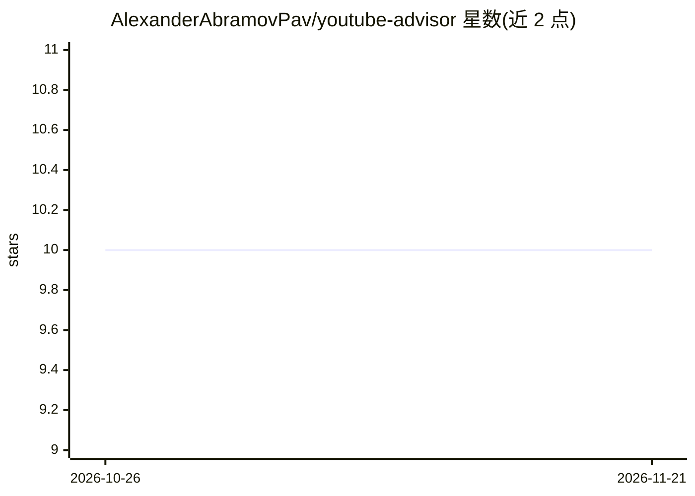

# AlexanderAbramovPav/youtube-advisor

⭐ 10 · Python · MIT · 推送 2026-10-25 · [GitHub](https://github.com/AlexanderAbramovPav/youtube-advisor) · 个人维护

**把任意 YouTube 频道构建为可问答的 AI 助手技能**

Python CLI 工具：抓取指定频道的视频字幕，建立 BM25 与语义检索索引（fastembed），生成本地 advisor 技能，回答带逐字引用和时间戳视频链接。定位为 Claude Code 等 agent 的技能（SKILL.md/AGENTS.md），也可作为纯 CLI 脚本使用；本地存储，无 API key，字幕缺失时回退本地 Whisper。限制包括每个 advisor 仅支持一个频道、Whisper 回退为 CPU 密集、受 YouTube 反爬策略影响。

## 筛选速览

| 维度 | 判定 | 备注 |
|---|---|---|
| AI 角色 | `ai-ecosystem` | LLM/agent 周边工具 |
| 许可风险 | `permissive` | MIT |
| 部署形态 | `library` | 以包/库形式分发 |
| 模型依赖 | — | README 未给出锁定关系 |
| 硬件要求 | — | 无带数字的原话,不猜 |
| 安装摩擦 | `medium` | 含编译或系统依赖之一 |
| 成熟度 | — | 结构信号不足 |

## 能力要点

- BM25 + 语义 RAG 检索，答案附逐字引用与精确到秒的时间戳链接
- 本地运行、无 API key、字幕缺失时回退本地 Whisper 转录
- 支持增量刷新：按原始筛选条件只拉取新视频并重建索引
- 支持 Claude Code、Codex CLI、Cursor、Continue.dev、Aider、Goose 等多种 agent 工具接入

## 适用场景

- 把喜欢的 YouTube 频道做成可追问的知识库助手
- 对播客/访谈内容做检索并点击时间戳核验原文
- 用 CLI 脚本在 CI/定时任务中批量构建与更新 advisor

## 场景标签

`RAG` `语义搜索` · 领域:知识与检索

## 证据(README 行号)

> L5:  Turn any YouTube channel into an AI assistant skill that answers questions with verbatim quotes and timestamped vid
> L76: - **Uses your AI's brain.** Skill drafting and answering run through whatever assistant you're already using — noth
> L96: `AGENTS.md` is a tool-agnostic mirror of `SKILL.md`. Wire it into whichever tool you use:

## 星数曲线

2026-10-26 10 → 2026-11-21 10（+0）

---
*卡片 v1 · prompt 1.4 · 生成 2026-11-20 · 置信度 high · 依据 README sha `d4b1cdac99d8` · [字段定义](../../DATASET.md)*
