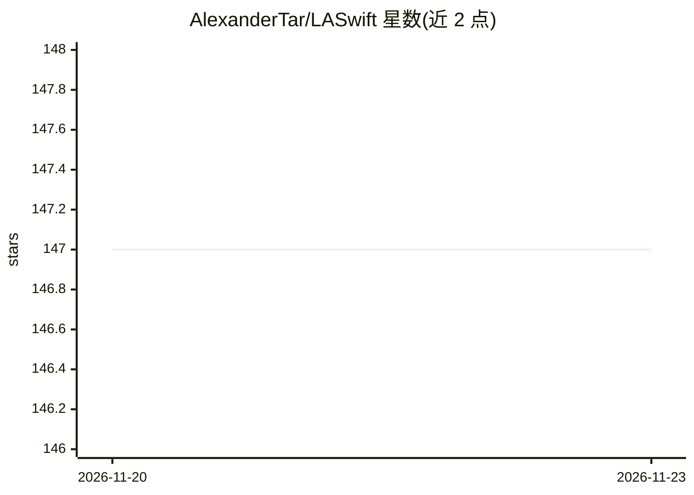

# AlexanderTar/LASwift

⭐ 147 · Swift · BSD-3-Clause · 推送 2026-11-19 · [GitHub](https://github.com/AlexanderTar/LASwift) · [官网](https://alexandertar.github.io/LASwift/documentation/laswift/) · 个人维护

**Swift 数值计算线性代数库，服务于 Apple 平台开发者**

为 Swift 提供 Matrix 类型与 Double 数组形式的 Vector，语法参照 Matlab 与 Haskell hmatrix。功能覆盖算术、指数对数、三角函数、统计量（sum/mean/std/normalize 等）、矩阵逆/行列式、特征值分解、SVD/广义 SVD/Cholesky、最小二乘及切片拼接等操作；Matrix 为值类型，支持 Sendable 与 Hashable。Apple 平台由 Accelerate（vDSP/BLAS/LAPACK）承担计算，Linux 依赖系统 LAPACK 与 BLAS。仅支持 Swift Package Manager，1.0 为破坏性版本并移除 CocoaPods/Carthage；Linux 侧矩阵维度超过 2,147,483,647 会终止程序。

## 筛选速览

| 维度 | 判定 | 备注 |
|---|---|---|
| AI 角色 | `ai-native` | 本体是模型或模型工具 |
| 许可风险 | `permissive` | BSD-3-Clause |
| 部署形态 | `None` |  |
| 模型依赖 | — | README 未给出锁定关系 |
| 硬件要求 | — | 无带数字的原话,不猜 |
| 安装摩擦 | `low` | 无编译、无系统依赖或容器化 |
| 成熟度 | — | 结构信号不足 |

## 能力要点

- 矩阵分解：SVD、广义 SVD、Cholesky、特征值（含复数）
- 种子可控的 rand/randn 与容差浮点比较 isApproximatelyEqual
- Matrix 为值类型：Sendable、Hashable、==精确比较
- Apple 平台由 Accelerate（vDSP/BLAS/LAPACK）执行计算

## 适用场景

- 在 iOS/macOS 应用中做数值计算与统计运算
- 为 Swift 端机器学习代码提供矩阵与向量基础操作
- 在 Linux 服务器上用 Swift 做线性代数计算

## 场景标签

 · 领域:数值计算/科学计算基础库

## 证据(README 行号)

> L14: LASwift gives Swift a `Matrix` type and a `Vector` (an array of `Double`) with the
> L15: operations you need for numerical code and machine learning. The syntax follows
> L28: - Statistics: `sum`, `mean`, `min`, `max`, `std` (sample by default), `normalize`

## 星数曲线

2026-11-20 147 → 2026-11-23 147（+0）

---
*卡片 v1 · prompt 1.4 · 生成 2026-11-20 · 置信度 mid · 依据 README sha `834d48081b67` · [字段定义](../../DATASET.md)*
