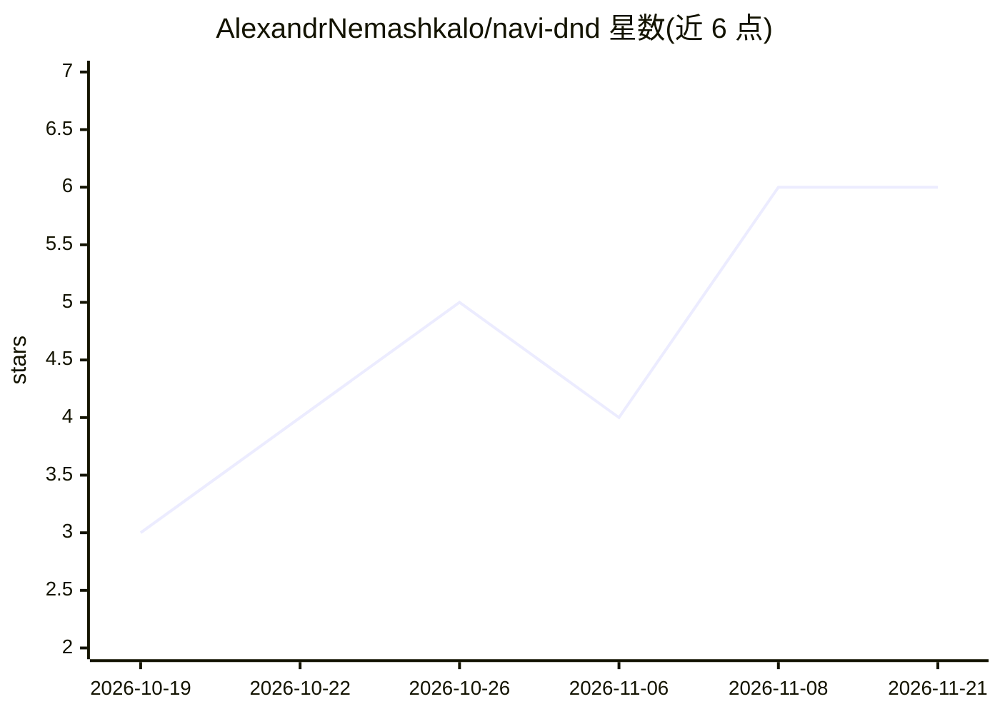

# AlexandrNemashkalo/navi-dnd

⭐ 6 · HTML · NOASSERTION · 推送 2026-11-18 · [GitHub](https://github.com/AlexandrNemashkalo/navi-dnd) · [官网](https://gitlab.com/navitalevich/navi-dnd/-/releases) · 个人维护

**以 Claude/Codex 为 AI 主持人的 D&D 5e 桌面角色扮演游戏**

一款桌面 RPG 游戏，其中神经网络担任地下城主（Dungeon Master）：根据 D&D 5e 规则引导剧情、演绎 NPC 并判定战斗。提供角色创建、基于格子地图的战术战斗、世界地图、角色表、战役日志以及离线语音旁白，并支持俄语和英语界面。Windows 和 macOS (Apple Silicon) 提供带有自动更新的安装程序；游戏在启动时检测已安装的 Claude Code 或 Codex CLI 并使用其进行游戏。许可为非商业用途，需保留署名，商业使用需要作者书面许可。

## 筛选速览

| 维度 | 判定 | 备注 |
|---|---|---|
| AI 角色 | `ai-native` | 本体是模型或模型工具 |
| 许可风险 | `none` | NOASSERTION |
| 部署形态 | `None` |  |
| 模型依赖 | — | README 未给出锁定关系 |
| 硬件要求 | — | 无带数字的原话,不猜 |
| 安装摩擦 | `low` | 无编译、无系统依赖或容器化 |
| 成熟度 | — | 结构信号不足 |

## 能力要点

- AI 主持人根据 D&D 5e 规则引导剧情
- 基于格子的战术地图和用于旅行的世界地图
- 离线语音旁白
- 支持俄语和英语界面，带自动更新

## 适用场景

- 无需人工主持人，即可进行由 AI 主持的 D&D 会话
- 创建角色并探索具有战术战斗的世界
- 使用俄语或英语进行桌面 RPG 游戏

## 场景标签

 · 领域:游戏/娱乐

## 证据(README 行号)

> L5: **Настольная ролевая игра, где мастер — нейросеть.**
> L20: - 🎲 **ИИ-мастер** — Claude или OpenAI Codex ведут игру по правилам D&D 5e

## 星数曲线

2026-10-19 3 → 2026-11-21 6（+3）

---
*卡片 v1 · prompt 1.4 · 生成 2026-11-20 · 置信度 high · 依据 README sha `3a715a0017ed` · [字段定义](../../DATASET.md)*
