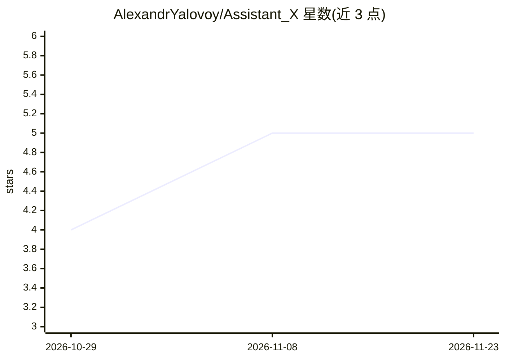

# AlexandrYalovoy/Assistant_X

⭐ 5 · Python · AGPL-3.0 · 推送 2026-11-05 · [GitHub](https://github.com/AlexandrYalovoy/Assistant_X) · 个人维护

**把本地文档库接入 Claude 等 MCP 客户端的问答检索服务**

将本地文件夹中的 PDF、扫描件、Office、EPUB 等文档摄取为私有知识库，通过 MCP 服务器向 Claude Desktop、Codex、LM Studio 等客户端提供检索与问答工具；回答附带文档编号、页码与逐字校验的引文，并可导出原页图片。检索采用词法（SQLite FTS5、俄/英词干化）与语义（bge-m3 嵌入、bge-reranker-v2-m3 重排）双路，扫描件经 Tesseract OCR 并给出逐页质量评分。支持 Windows/Linux、Python 3.11，GNU AGPL-3.0 许可，版本 0.6.1 标注为 prototype。

## 筛选速览

| 维度 | 判定 | 备注 |
|---|---|---|
| AI 角色 | `ai-native` | 本体是模型或模型工具 |
| 许可风险 | `viral` | AGPL-3.0 |
| 部署形态 | `desktop` | 安装包/桌面程序 |
| 模型依赖 | — | README 未给出锁定关系 |
| 硬件要求 | `cpu-ok` | |
| 安装摩擦 | `medium` | 含编译或系统依赖之一 |
| 成熟度 | `idea` | |

## 能力要点

- 回答引用文档编号、条款/页码，引文逐字对页校验并可展示原页图片
- 支持 PDF/扫描件/Office/EPUB/DjVu/邮件附件等格式，OCR 带逐页质量评分
- bge-m3 语义检索 + bge-reranker 重排 + 俄英双语词法检索
- 一条命令自动配置多个 MCP 客户端，单本地服务共享模型给全部应用

## 适用场景

- 让 Claude 回答我的标准、规范、论文库中的问题并给出原文出处
- 在离线环境中把大量扫描件建成可检索的私有资料库
- 在 Claude、Codex、LM Studio 等多个客户端共用同一个本地文档库
- 向团队分发整理好的文档库基础包

## 场景标签

`RAG` `语义搜索` `OCR` `文档问答` · 领域:知识与检索

## 证据(README 行号)

> L5: **Ask your own library. Get answers with the document, the page and the exact quote.**
> L10: answers with an exact quote. The library runs on your computer and works with Claude, Codex, the ChatGPT desktop ap
> L62: - By meaning: the multilingual model bge-m3, so a question in Russian finds an English text and the other way round

## 星数曲线

2026-10-29 4 → 2026-11-23 5（+1）

---
*卡片 v1 · prompt 1.4 · 生成 2026-11-21 · 置信度 mid · 依据 README sha `edaf8ee29917` · [字段定义](../../DATASET.md)*
