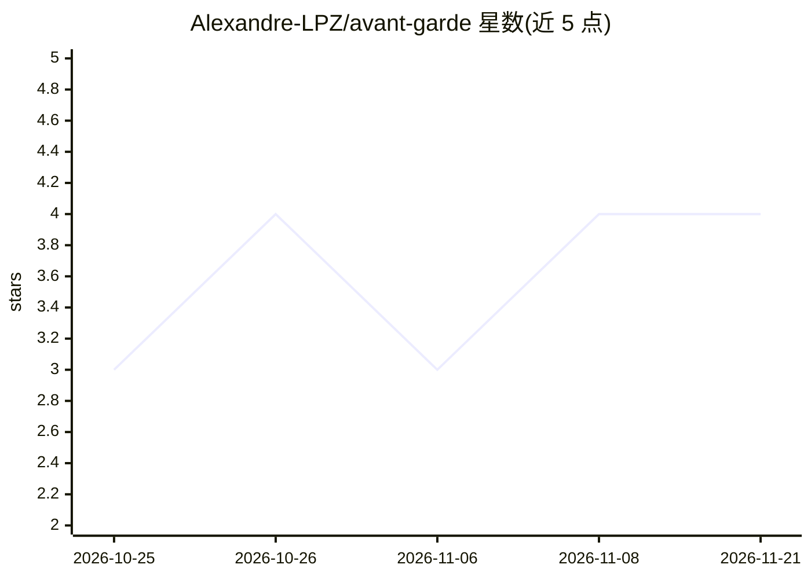

# Alexandre-LPZ/avant-garde

⭐ 4 · MIT · 推送 2026-10-18 · [GitHub](https://github.com/Alexandre-LPZ/avant-garde) · 个人维护

**给 Claude 加先写文档再写码的流程技能与安全门**

一个面向 Claude（claude.ai 与 Claude Code）的技能包：在 AI 构建网站/应用前强制先完成六份基础文档（PRD、应用流程、设计简报、技术选型、数据与权限、构建计划），上线前执行十项安全检查（.gitignore、行级权限、密钥不进浏览器、AI 路由限流等）。面向用 AI 构建的非开发者（vibe coders、独立开发者、学生、独立创始人），文档充当人机协作的共享记忆，每次会话可通过 CLAUDE.md 恢复上下文。提供法/英双语版本，MIT 许可。

## 筛选速览

| 维度 | 判定 | 备注 |
|---|---|---|
| AI 角色 | `ai-ecosystem` | LLM/agent 周边工具 |
| 许可风险 | `permissive` | MIT |
| 部署形态 | `None` |  |
| 模型依赖 | locked-api |  |
| 硬件要求 | — | 无带数字的原话,不猜 |
| 安装摩擦 | `low` | 无编译、无系统依赖或容器化 |
| 成熟度 | — | 结构信号不足 |

## 能力要点

- 六份基础文档流程（30 秒项目分级，轻量轨 3 份/完整轨 6 份）
- 十项可由非开发者自查的安全门检查
- 写入 CLAUDE.md 使后续会话自动遵循文档
- 拒绝跳过基础文档时仅允许标记为一次性的原型路径

## 适用场景

- 用 AI 从零构建带账户/数据库/支付的应用前补齐需求文档
- 非开发者上线 AI 生成应用前做安全自查
- 多人会话间保持项目基础文档的连续性

## 场景标签

 · 领域:AI 辅助开发/安全

## 证据(README 行号)

> L5: *Avant-Garde* is a skill for Claude (claude.ai & Claude Code) that stops your AI from writing a single line of code 
> L31: Avant-Garde fixes both problems with one method: **six short documents + a ten-point security gate**, written toget
> L37: 1. **Triages** your project (30 seconds): static page → light track (3 docs); accounts, database, payments or AI ca

## 星数曲线

2026-10-25 3 → 2026-11-21 4（+1）

---
*卡片 v1 · prompt 1.4 · 生成 2026-11-21 · 置信度 high · 依据 README sha `b9961e311e2c` · [字段定义](../../DATASET.md)*
