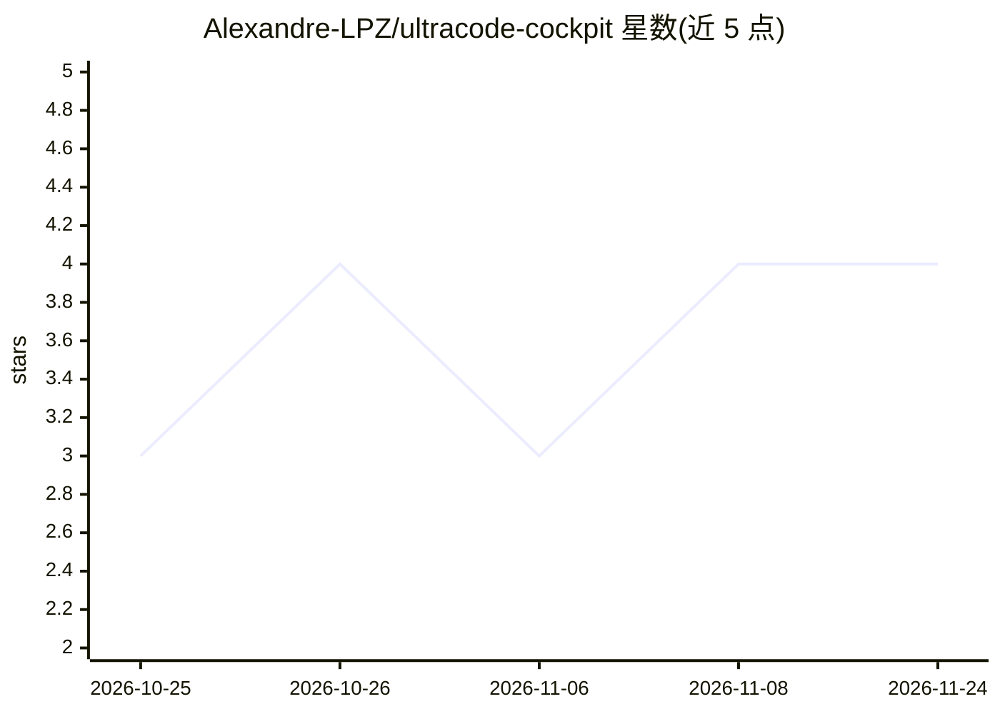

# Alexandre-LPZ/ultracode-cockpit

⭐ 4 · MIT · 推送 2026-10-17 · [GitHub](https://github.com/Alexandre-LPZ/ultracode-cockpit) · 个人维护

**约束 ultracode/动态工作流支出的 Claude 技能：先估价再花钱**

一个面向 claude.ai 与 Claude Code 的技能（SKILL.md），用于治理 ultracode / Dynamic Workflows 模式下的 agent 与 token 消耗。机制包括：三级分流（徒手/≤5 子代理/全功率）、启动前的五项开销估算表（GO/T1/T2/T3/STOP 确认制）、子代理简报规则、中途估算检查点与 kill-switch、使用后的关机与飞行报告。易变事实集中于 §0 参考块，检测到漂移时生成补丁块供粘贴。提供英法双语版本，经 MIT 许可。

## 筛选速览

| 维度 | 判定 | 备注 |
|---|---|---|
| AI 角色 | `ai-ecosystem` | LLM/agent 周边工具 |
| 许可风险 | `permissive` | MIT |
| 部署形态 | `None` |  |
| 模型依赖 | locked-api |  |
| 硬件要求 | — | 无带数字的原话,不猜 |
| 安装摩擦 | `low` | 无编译、无系统依赖或容器化 |
| 成熟度 | — | 结构信号不足 |

## 能力要点

- 三级分流：T1 徒手 / T2 ≤5 子代理 / T3 全功率 ultracode
- 启动前估算表，需显式 GO 才可发射
- 中途估算检查点与 kill-switch，防沉没成本螺旋
- §0 参考块隔离易变事实，漂移时自动生成补丁

## 适用场景

- 在使用 ultracode 模式前控制 agent 数量与 token 支出
- 为 Claude Code 会话加装一次性的预算守门规则
- 团队中规范子代理委派与工作流开销报告

## 场景标签

 · 领域:LLM 基础设施/成本治理

## 证据(README 行号)

> L5: *UltraCode Cockpit* is a skill for Claude (claude.ai & Claude Code) that governs **ultracode / Dynamic Workflows** —
> L22: 3. **Estimate before spend** — a 5-line table (agents cap, effort, cost class, why); you answer in one word: GO / T

## 星数曲线

2026-10-25 3 → 2026-11-24 4（+1）

---
*卡片 v1 · prompt 1.4 · 生成 2026-11-21 · 置信度 high · 依据 README sha `c2f2a67be957` · [字段定义](../../DATASET.md)*
