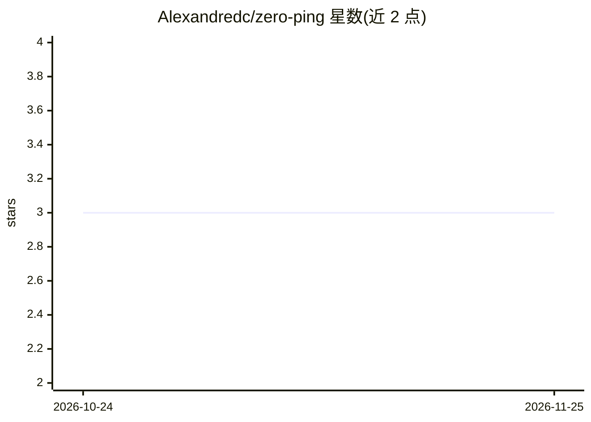

# Alexandredc/zero-ping

⭐ 3 · TypeScript · MIT · 推送 2026-11-10 · [GitHub](https://github.com/Alexandredc/zero-ping) · [官网](https://alexandredc.github.io/zero-ping/) · 个人维护

**本地优先的开发负责人收件箱：AI 排序 GitHub 通知与 PR**

在本机运行的收件箱应用，用排序列表替代 GitHub 通知邮件：待 review 的 PR、等回复的 mention、自己的 PR、issue 与 sprint 看板。每条目带可解释的 0–100 优先级分数（默认确定性规则打分）、AI 摘要与操作入口。AI 功能通过本机已装的编码代理（Claude Code 或 Codex）以 headless 方式执行，数据存于本地 PGlite 数据库，服务器绑定 127.0.0.1。无代理时收件箱、团队视图与看板仍可使用；界面为法语。

## 筛选速览

| 维度 | 判定 | 备注 |
|---|---|---|
| AI 角色 | `ai-enhanced` | 去掉 AI 部分产品仍成立 |
| 许可风险 | `permissive` | MIT |
| 部署形态 | `library` | 以包/库形式分发 |
| 模型依赖 | — | README 未给出锁定关系 |
| 硬件要求 | — | 无带数字的原话,不猜 |
| 安装摩擦 | `low` | 无编译、无系统依赖或容器化 |
| 成熟度 | — | 结构信号不足 |

## 能力要点

- AI 摘要/问答/自然语言搜索经本机编码代理（Claude Code 或 Codex）执行
- 可解释的 0–100 优先级分数，无 Jev key 时用确定性规则排序
- GitHub 通知轮询 + GraphQL 富化 + 本地 PGlite 存储，绑定 127.0.0.1
- 内置 demo 模式：虚构数据运行，不读不发 GitHub/Slack/AI

## 适用场景

- 集中处理 GitHub PR review、通知与 sprint，替代通知邮件
- 用 AI 摘要快速了解 PR 现状与待办动作
- 团队视图查看卡住的 PR 与 review 延迟
- 在 demo 数据上离线试用全部界面功能

## 场景标签

 · 领域:开发者工具/生产力

## 证据(README 行号)

> L13: It runs on your machine, uses your `gh` login and your coding agent (Claude Code or Codex), and stores everything i
> L70: |**Claude Code** with the claude.ai **Slack connector**, or **Codex** with a **Slack MCP server**|all AI features a

## 星数曲线

2026-10-24 3 → 2026-11-25 3（+0）

---
*卡片 v1 · prompt 1.4 · 生成 2026-11-22 · 置信度 high · 依据 README sha `95e1a2994a1c` · [字段定义](../../DATASET.md)*
