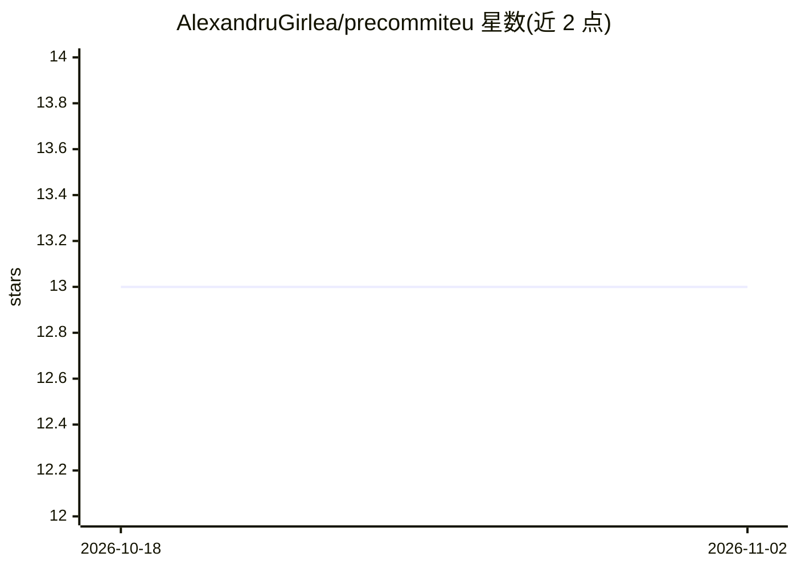

# AlexandruGirlea/precommiteu

⭐ 13 · Python · Apache-2.0 · 推送 2026-10-11 · [GitHub](https://github.com/AlexandruGirlea/precommiteu) · [官网](https://precommit.eu) · 个人维护

**本地 LLM 静态扫描器：在 PR 时检测代码中的欧盟法规违规**

纯 Python 扫描器，针对 GDPR、欧盟 AI 法案、NIS2、DORA、CRA、DSA、DMA 与 Data Act 八项法规，在本地 llama-server 进程上运行基础 GGUF 模型与按法规训练的检测 LoRA 适配器，零数据外传。检测器提出候选，验证器须在源文件中逐字定位证据，确认项引用行号并可阻断构建；未确认项仅作标注提示。提供 CLI、Python API、本地 Web UI 与 GitHub Actions 集成，支持增量扫描与 SARIF 报告。作者声明输出为合规信号而非法律意见。

## 筛选速览

| 维度 | 判定 | 备注 |
|---|---|---|
| AI 角色 | `ai-native` | 本体是模型或模型工具 |
| 许可风险 | `permissive` | Apache-2.0 |
| 部署形态 | `library` | 以包/库形式分发 |
| 模型依赖 | local-ok | 支持本地模型 |
| 硬件要求 | — | 无带数字的原话,不猜 |
| 安装摩擦 | `low` | 无编译、无系统依赖或容器化 |
| 成熟度 | — | 结构信号不足 |

## 能力要点

- 检测器+验证器两级机制：候选须逐字定位证据，确认发现引用行号
- 本地 llama-server 运行 GGUF 基础模型+按法规 LoRA 适配器，无网络外传
- 六种适配器包覆盖八项欧盟法规，按需下载
- 支持 CI 门禁（--ci --fail-on-findings）、增量扫描与本地 Web UI

## 适用场景

- 在 PR 阶段拦截代码中的 GDPR/AI 法案等欧盟法规违规
- 合规团队在本地扫描代码库并生成 SARIF 报告
- 企业为出口欧盟的产品做持续合规信号检查

## 场景标签

`代码审查` · 领域:编码与开发

## 证据(README 行号)

> L8:  One local scanner, eight EU regulations: GDPR, the EU AI Act, NIS2, DORA, the
> L138: - **Your code never leaves your machine.** All analysis runs on local
> L142:  then has to locate the quoted evidence verbatim in your file, or the

## 星数曲线

2026-10-18 13 → 2026-11-02 13（+0）

---
*卡片 v1 · prompt 1.4 · 生成 2026-10-31 · 置信度 high · 依据 README sha `3fe9cadffd22` · [字段定义](../../DATASET.md)*
