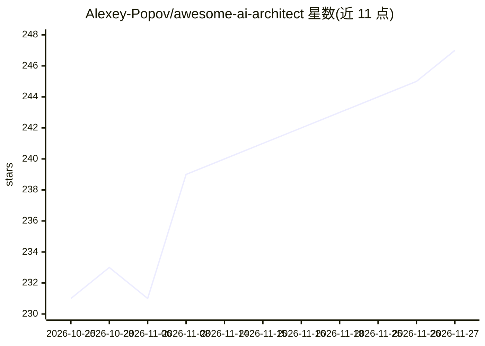

# Alexey-Popov/awesome-ai-architect

⭐ 247 · MIT · 推送 2026-11-18 · [GitHub](https://github.com/Alexey-Popov/awesome-ai-architect) · 个人维护

**面向解决方案架构师的 AI 系统设计学习资源清单**

一个 awesome 类型的知识清单，按核心主题、AI 系统设计、软件工程技能、学习资源、职业发展与面试准备等板块组织条目，覆盖 RAG/agent 架构模式、向量存储、推理基础设施、可观测性、安全护栏、多租户、成本经济、架构决策记录等内容。每个条目页面采用统一结构（TL;DR、Quickstart、关键概念、真实案例、常见陷阱等），条目附来源出处。定位读者是希望掌握 AI 工程与解决方案架构结合的架构师与顾问。

## 筛选速览

| 维度 | 判定 | 备注 |
|---|---|---|
| AI 角色 | `ai-knowledge` | 知识聚合/清单类 |
| 许可风险 | `permissive` | MIT |
| 部署形态 | `None` |  |
| 模型依赖 | — | README 未给出锁定关系 |
| 硬件要求 | — | 无带数字的原话,不猜 |
| 安装摩擦 | `low` | 无编译、无系统依赖或容器化 |
| 成熟度 | — | 结构信号不足 |

## 能力要点

- 按核心主题/系统设计/工程技能/职业/面试五大板块组织条目
- 每个条目页面遵循 TL;DR→Quickstart→关键概念→真实案例的统一结构
- 包含模型路由、多 LLM 策略、KV Cache 成本、Agent 协议等 AI 架构专题
- 以 Mermaid 图表展示架构

## 适用场景

- 学习如何将 RAG、agent、推理服务设计进可扩展的系统架构
- 准备 GenAI 系统设计面试与架构师认证
- 为 AI 平台规划多租户、限流、缓存与成本核算方案

## 场景标签

`精选清单` `教程课程` · 领域:学习与行业

## 证据(README 行号)

> L108: This repository curates learning resources, certifications, career tips, and interview prep materials to help you 
> L116: - **Curated resources** from official docs, reputable sources, and "awesome" lists

## 星数曲线

2026-10-25 231 → 2026-11-27 247（+16）

---
*卡片 v1 · prompt 1.4 · 生成 2026-11-25 · 置信度 high · 依据 README sha `1968f5f82aba` · [字段定义](../../DATASET.md)*
