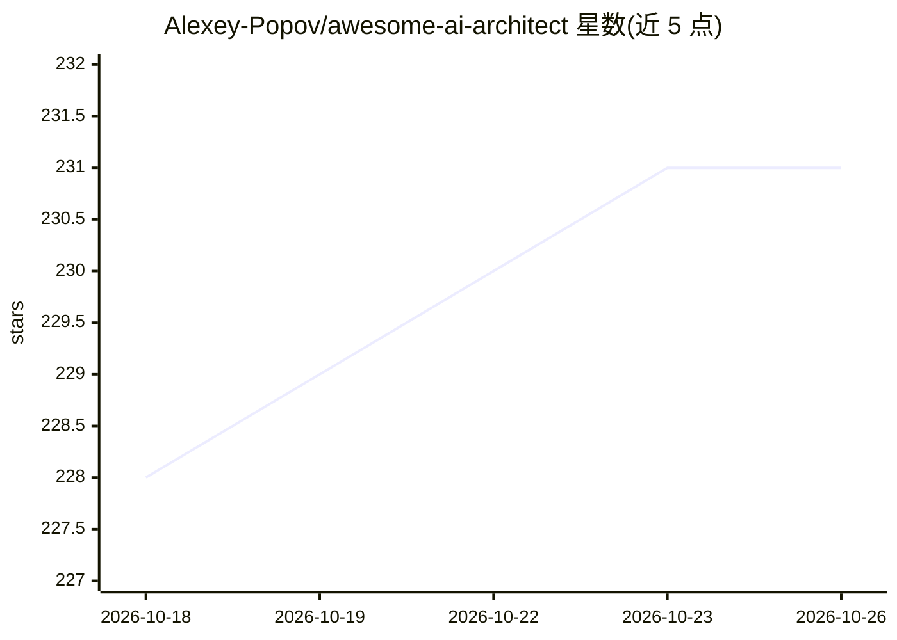

# Alexey-Popov/awesome-ai-architect

⭐ 231 · MIT · 推送 2026-10-19 · [GitHub](https://github.com/Alexey-Popov/awesome-ai-architect) · 个人维护

**面向 AI 架构师的英文学习资源与面试准备清单**

一个 awesome-list 仓库，为希望成为 AI 方案架构师的读者策展学习材料：主题覆盖 RAG、向量存储、推理基础设施、评测与可观测、安全与红队、多云与模型路由等 AI 架构核心议题，并包含软件工程 AI 技能、认证、职业发展与面试准备板块。每个主题页面遵循统一结构（TL;DR、Quickstart、Key Concepts、Common Pitfalls 等），使用 Mermaid 图与来源标注。仓库以 Markdown 指南形式提供，无安装步骤，MIT 许可。

## 筛选速览

| 维度 | 判定 | 备注 |
|---|---|---|
| AI 角色 | `ai-knowledge` | 知识聚合/清单类 |
| 许可风险 | `permissive` | MIT |
| 部署形态 | `None` |  |
| 模型依赖 | — | README 未给出锁定关系 |
| 硬件要求 | — | 无带数字的原话,不猜 |
| 安装摩擦 | `low` | 无编译、无系统依赖或容器化 |
| 成熟度 | — | 结构信号不足 |

## 能力要点

- 覆盖 RAG、代理、推理基础设施、安全与红队等 AI 架构主题
- 每个主题页面有统一结构：TL;DR、Quickstart、常见陷阱等
- 包含认证、职业指南与 GenAI 系统设计面试准备内容

## 适用场景

- 系统性学习 AI 工程与方案架构知识
- 准备 AI/方案架构师面试与认证
- 按目录查找 RAG、模型路由、多云等特定主题的入门指引

## 场景标签

`精选清单` · 领域:学习与行业

## 证据(README 行号)

> L78: This repository curates learning resources, certifications, career tips, and interview prep materials to help you g
> L86: - **Curated resources** from official docs, reputable sources, and "awesome" lists

## 星数曲线

2026-10-18 228 → 2026-10-26 231（+3）

---
*卡片 v1 · prompt 1.4 · 生成 2026-10-22 · 置信度 high · 依据 README sha `5773d2d0808e` · [字段定义](../../DATASET.md)*
