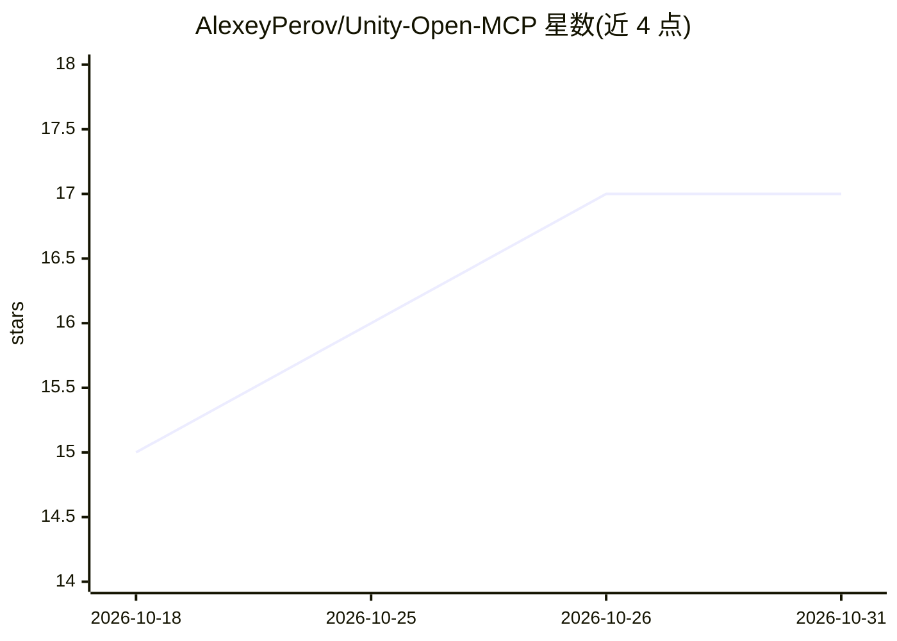

# AlexeyPerov/Unity-Open-MCP

⭐ 17 · C# · MIT · 推送 2026-10-29 · [GitHub](https://github.com/AlexeyPerov/Unity-Open-MCP) · 个人维护 · 中文 README

**让 AI agent 通过 MCP 控制与测试 Unity 项目的工具集**

面向 Unity 开发者的开源 MCP 实现：在 Claude Code、Cursor、ZCode 等 AI agent 与 Unity 编辑器之间充当桥接层，提供 270+ 类型化工具。能力覆盖 GameObject/场景/材质等的安全变更（checkpoint→mutate→validate→delta 门控）、让 agent 实际游玩游戏并产出 Markdown 测试报告的 Playtest、Edit/Play Mode 测试运行、控制台与性能数据读取。支持实时编辑器、无头编辑器与离线磁盘三种执行路径，含 CLI 安装与 CI 流程。要求 Unity 2022.3 LTS+ 与 Node.js 18+。

## 筛选速览

| 维度 | 判定 | 备注 |
|---|---|---|
| AI 角色 | `ai-ecosystem` | LLM/agent 周边工具 |
| 许可风险 | `permissive` | MIT |
| 部署形态 | `library` | 以包/库形式分发 |
| 模型依赖 | — | README 未给出锁定关系 |
| 硬件要求 | — | 无带数字的原话,不猜 |
| 安装摩擦 | `low` | 无编译、无系统依赖或容器化 |
| 成熟度 | `idea` | |

## 能力要点

- 270+ 类型化工具，变更走 checkpoint→mutate→validate→delta 门控
- agent 可游玩运行中的游戏并生成含帧与控制台错误的 Markdown 报告
- 支持实时编辑器、无头编辑器与离线磁盘读取三种执行路径
- npx 一条命令安装，含 monorepo 可提交的可移植配置

## 适用场景

- 让 AI agent 按自然语言指令修改 Unity 场景与脚本
- 自动化冒烟测试并生成可人工复核的测试报告
- 在 CI 中运行 Unity 测试与回归门控

## 场景标签

`编码 Agent` · 领域:编码与开发

## 证据(README 行号)

> L11: Unity Open MCP is one of the broadest open-source MCP implementations for Unity,
> L12: with **270+ typed tools** in a production-oriented automation stack. Safety-gated
> L103:    npx -y unity-open-mcp@latest setup --client cursor

## 星数曲线

2026-10-18 15 → 2026-10-31 17（+2）

---
*卡片 v1 · prompt 1.4 · 生成 2026-10-30 · 置信度 high · 依据 README sha `1f0d42724bf5` · [字段定义](../../DATASET.md)*
