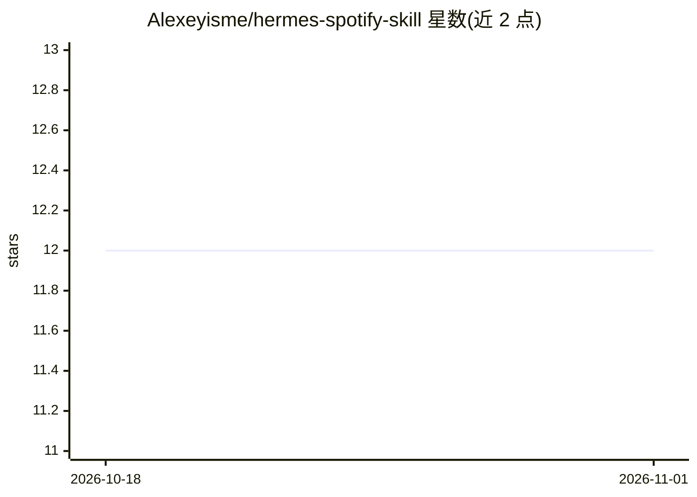

# Alexeyisme/hermes-spotify-skill

⭐ 12 · Python · MIT · 推送 2026-05-02 · [GitHub](https://github.com/Alexeyisme/hermes-spotify-skill) · 个人维护

**Hermes Agent 的 Spotify 播放控制 MCP 技能**

面向 Hermes Agent 的 Spotify 播放控制技能：以 stdio MCP 服务器（spotify_mcp.py）加 SKILL.md 形式提供，封装 spotipy，暴露 12 个工具（play/pause/volume/queue/设备切换等），把 OAuth 缓存、scope 处理、设备唤醒等逻辑放在 Python 侧，agent 只需选工具填 0-2 个参数。适用于 Linux/Raspberry Pi 4/5，需 Spotify Premium 账号与用户在浏览器完成 OAuth 授权；可配合 raspotify 将 Pi 作为 Spotify Connect 音箱。安装需 pip 装依赖、克隆仓库、手动编辑 config.yaml 注册。

## 筛选速览

| 维度 | 判定 | 备注 |
|---|---|---|
| AI 角色 | `ai-ecosystem` | LLM/agent 周边工具 |
| 许可风险 | `permissive` | MIT |
| 部署形态 | `library` | 以包/库形式分发 |
| 模型依赖 | local-ok | 支持本地模型 |
| 硬件要求 | — | 无带数字的原话,不猜 |
| 安装摩擦 | `low` | 无编译、无系统依赖或容器化 |
| 成熟度 | — | 结构信号不足 |

## 能力要点

- 12 个 Spotify 工具（播放/暂停/音量/队列/设备管理等）经 MCP 协议注册
- OAuth 缓存与错误映射封装在 Python 侧，工具参数仅 0-2 个，适配小/本地模型
- 支持任何无头 Linux，测试于 Raspberry Pi OS Lite Bookworm 64-bit
- 可选配置 raspotify 将 Raspberry Pi 作为 Spotify Connect 音箱

## 适用场景

- 让 Hermes Agent 通过自然语言控制 Spotify 播放
- 在树莓派上搭建可语音/对话控制的 Spotify 音箱
- 跨设备转移 Spotify 播放、查看当前播放与可用设备

## 场景标签

 · 领域:智能家居/音乐控制

## 证据(README 行号)

> L5: Since **v1.0.0** this skill ships as a thin MCP server (`spotify_mcp.py`) plus a ~1.5KB `SKILL.md`. The MCP server e
> L11: **How it works:** `spotify_mcp.py` is a stdio MCP server that wraps spotipy. Hermes' built-in MCP client (see the `

## 星数曲线

2026-10-18 12 → 2026-11-01 12（+0）

---
*卡片 v1 · prompt 1.4 · 生成 2026-11-01 · 置信度 high · 依据 README sha `65923b2378d1` · [字段定义](../../DATASET.md)*
