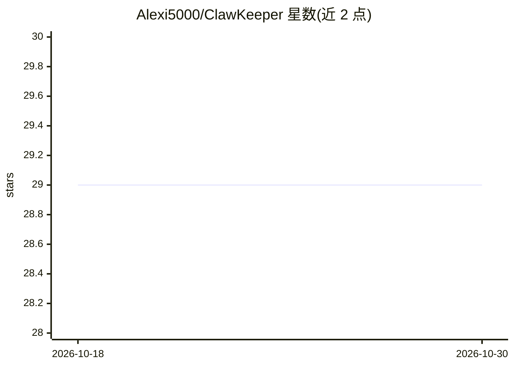

# Alexi5000/ClawKeeper

⭐ 29 · TypeScript · MIT · 推送 2026-10-26 · [GitHub](https://github.com/Alexi5000/ClawKeeper) · 个人维护 · 中文 README

**面向 SMB 财务 agent 的治理控制平面：审批门、租户隔离与审计日志**

ClawKeeper 是给中小企业的财务 agent 控制平面：110 个三层 agent（1 CEO + 9 域主管 + 100 工人）承接应付、应收、对账、报表等工作，但在每次 LLM 调用前由确定性 TypeScript 策略引擎裁决，付款与高风险操作需人工审批，PostgreSQL RLS 与追加触发器实现租户隔离和不可改审计日志，PII/密钥写入前脱敏。明确不做无审批自主资金执行、不做 LLM 参与安全决策、不无限 LLM 花费，并提供离线合成数据的 v2 证明包与 CI 质量门。面向不希望 agent 获得自主资金权限的运营者与开发者。

## 筛选速览

| 维度 | 判定 | 备注 |
|---|---|---|
| AI 角色 | `ai-ecosystem` | LLM/agent 周边工具 |
| 许可风险 | `permissive` | MIT |
| 部署形态 | `self-host` | docker 或自建部署 |
| 模型依赖 | — | README 未给出锁定关系 |
| 硬件要求 | — | 无带数字的原话,不猜 |
| 安装摩擦 | `low` | 无编译、无系统依赖或容器化 |
| 成熟度 | — | 结构信号不足 |

## 能力要点

- LLM 调用前运行确定性策略引擎（src/openclaw/policy.ts）
- 付款等高风险操作缺审批元数据即拒绝执行
- PostgreSQL RLS 租户隔离 + 追加触发器不可改审计日志（含脱敏）
- v2 离线合成数据证明包与 FDE 基准（147 项测试通过，CI 含 RLS 边界测试）

## 适用场景

- 让 LLM agent 处理记账、发票与对账但不授予自主资金执行权
- 多租户会计团队需要租户数据隔离与审批门槛
- 研究财务 agent 守护栏模式的开发者评估确定性策略引擎实现

## 场景标签

`多智能体` · 领域:Agent 开发

## 证据(README 行号)

> L23: **What it does.** ClawKeeper is a control plane for finance agents in small and medium businesses. Agents propose a
> L48: ClawKeeper models a finance department as a three-layer agent hierarchy: one CEO orchestrator, nine domain leads, a

## 星数曲线

2026-10-18 29 → 2026-10-30 29（+0）

---
*卡片 v1 · prompt 1.4 · 生成 2026-10-26 · 置信度 high · 依据 README sha `d5ced004d274` · [字段定义](../../DATASET.md)*
