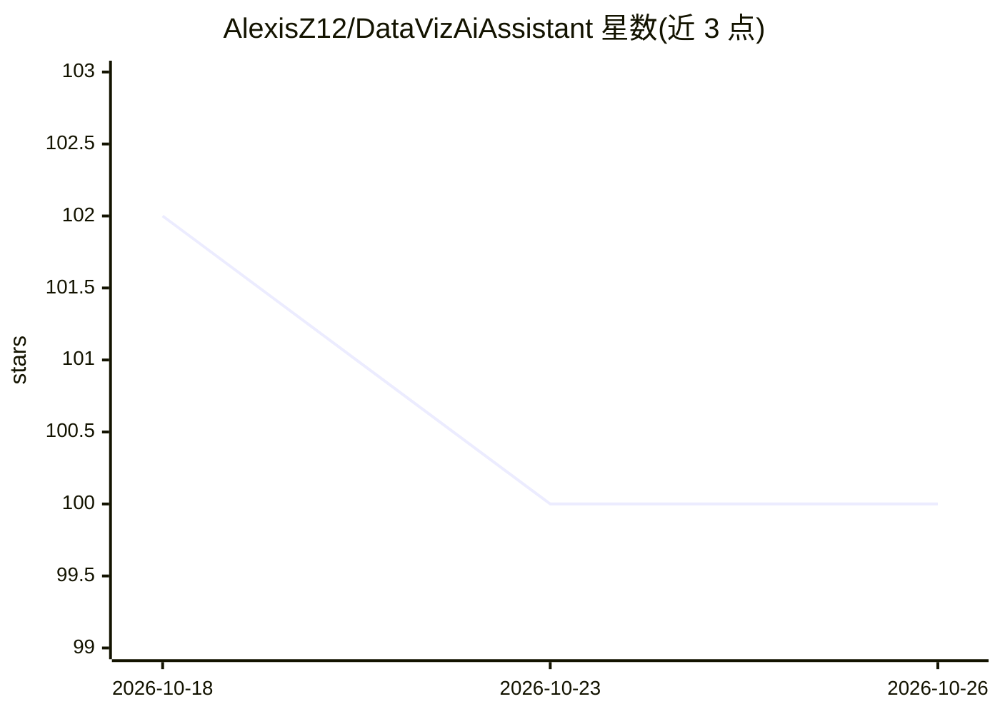

# AlexisZ12/DataVizAiAssistant

⭐ 100 · Python · MIT · 推送 2026-08-09 · [GitHub](https://github.com/AlexisZ12/DataVizAiAssistant) · [官网](http://118.25.26.232:5173/) · 个人维护 · 中文 README

**自然语言驱动的 Matplotlib 图表生成助手，支持7种图表**

前后端分离（React + FastAPI）的 Web 应用与 CLI Skill：用户以自然语言描述数据和分析需求，多阶段 LLM 流水线解析后自动生成 Matplotlib 图表，支持线图、散点图、条形图等7种类型，并支持数据与样式的交互式二次修改。通过 OpenAI 标准 API 接入，兼容 DeepSeek、Ollama、LmStudio 等平台，配置文件或前端临时输入切换接口；API 密钥本地存储。另有 /dataviz-ai 命令，可集成到 OpenClaw、Claude Code 等 AI 编程助手中。需自备 LLM API 密钥，图表质量取决于 LLM 理解准确性。

## 筛选速览

| 维度 | 判定 | 备注 |
|---|---|---|
| AI 角色 | `ai-native` | 本体是模型或模型工具 |
| 许可风险 | `permissive` | MIT |
| 部署形态 | `library` | 以包/库形式分发 |
| 模型依赖 | local-ok | 支持本地模型 |
| 硬件要求 | — | 无带数字的原话,不猜 |
| 安装摩擦 | `low` | 无编译、无系统依赖或容器化 |
| 成熟度 | — | 结构信号不足 |

## 能力要点

- 自然语言生成7种 Matplotlib 图表类型
- 数据与样式的交互式二次修改，实时预览
- OpenAI 标准 API，兼容 DeepSeek/Ollama/LmStudio，接口配置切换
- CLI Skill 模式（/dataviz-ai）可作为 AI 编程助手插件，输出 PNG

## 适用场景

- 不会编程也能把文字数据描述转成图表
- 数据分析、报告生成中快速产出可视化配图
- 在 Claude Code 等 AI 编程助手中直接调用图表生成

## 场景标签

`数据分析` · 领域:效率与自动化

## 证据(README 行号)

> L3: **AI驱动的数据可视化助手** — 基于大语言模型的智能图表生成工具，让数据可视化变得触手可及。无需编程基础，只需用自然语言描述您的数据和分析需求，即可自动生成专业的 Matplotlib 可视化图表。支持线图、散点图、条形图等7
> L16: **DataVizAiAssistant** 是一个创新的开源工具，结合人工智能技术与数据可视化功能，帮助用户轻松从自然语言描述生成专业的数据可视化图表。项目使用大语言模型（通过 OpenAI 或兼容接口）解析用户需求，自动生成 
> L41:  支持OpenAI标准API，兼容DeepSeek、Ollama、LmStudio等替代平台，配置文件管理接口切换

## 星数曲线

2026-10-18 102 → 2026-10-26 100（-2）

---
*卡片 v1 · prompt 1.4 · 生成 2026-10-23 · 置信度 high · 依据 README sha `661db963681d` · [字段定义](../../DATASET.md)*
