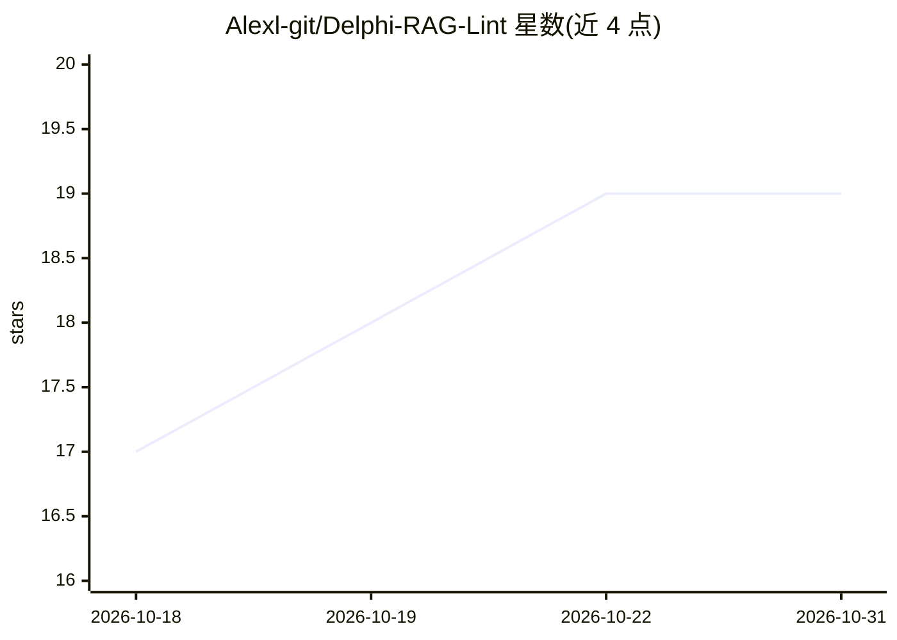

# Alexl-git/Delphi-RAG-Lint

⭐ 19 · Pascal · MIT · 推送 2026-10-30 · [GitHub](https://github.com/Alexl-git/Delphi-RAG-Lint) · 个人维护

**Delphi/Pascal 源码的符号索引、检索、lint 与重构工具**

纯 Object Pascal 运行时的 Delphi 代码智能工具：基于 tree-sitter-delphi13 建立符号级索引，提供 AST 精确与模糊查询、调用者查找、lint 与自动修复、语义编译检查（独立进程执行避免 IDE 卡顿）。可作为 CLI、LSP 服务器（Zed/VS Code）、MCP 服务器（Claude/Cursor）及 RAD Studio 13 插件使用；含 25 种形式化问答图表（change-impact/deps/butterfly 等），每行结果带文件与行号。作者声明为早期 alpha，不建议无人值守/生产使用。

## 筛选速览

| 维度 | 判定 | 备注 |
|---|---|---|
| AI 角色 | `ai-ecosystem` | LLM/agent 周边工具 |
| 许可风险 | `permissive` | MIT |
| 部署形态 | `desktop` | 安装包/桌面程序 |
| 模型依赖 | — | README 未给出锁定关系 |
| 硬件要求 | — | 无带数字的原话,不猜 |
| 安装摩擦 | `medium` | 含编译或系统依赖之一 |
| 成熟度 | `idea` | |

## 能力要点

- 符号级索引与 AST 精确查询（find-callers/surface/context 等 CLI 动词）
- CLI / LSP / MCP / RAD Studio 插件四种使用形态
- 25 种形式化问答图表，结果均带文件与行号溯源
- AI agent 经 CLI 或 MCP 调用，读取 token 比打开整个单元少约 10-60 倍

## 适用场景

- 在大型 Delphi 项目中查询符号、调用者与变更影响
- 为 Claude/Cursor 等 agent 提供低 token 消耗的代码上下文
- 对 Delphi 源码运行 lint 并自动修复可修复项

## 场景标签

 · 领域:开发者工具/静态分析

## 证据(README 行号)

> L13: A symbol-aware retrieval + lint + refactoring + IDE-integration tool for Delphi.
> L16: **Use it as:** CLI tool &middot; LSP server (Zed / VS Code) &middot; MCP server (Claude / Cursor) &middot; RAD Stud
> L18: **Driving it from an AI agent? See docs/AI-USAGE.md** -- copy-paste instructions so your AI uses drag-lint over CLI

## 星数曲线

2026-10-18 17 → 2026-10-31 19（+2）

---
*卡片 v1 · prompt 1.4 · 生成 2026-10-29 · 置信度 high · 依据 README sha `2c630b39bc7c` · [字段定义](../../DATASET.md)*
