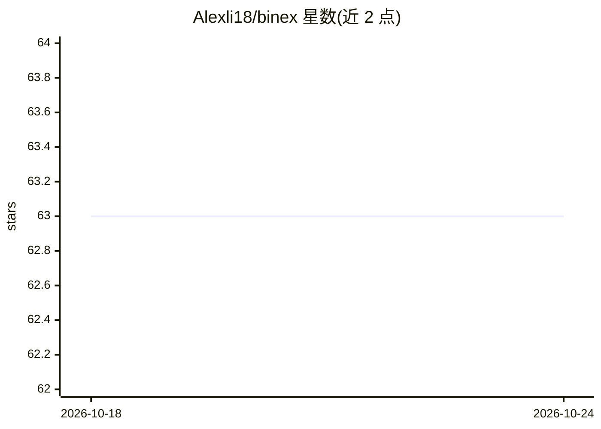

# Alexli18/binex

⭐ 63 · Python · MIT · 推送 2026-10-18 · [GitHub](https://github.com/Alexli18/binex) · [官网](https://alexli18.github.io/binex) · 个人维护

**本地优先的 AI agent 工作流可视化编排与调试运行时**

开源的 AI agent 工作流运行时：通过 Web UI 拖拽编辑器或 YAML/CLI 构建 DAG 多智能体流水线，节点类型覆盖 LLM Agent、本地脚本、人工输入/审批/输出、A2A 远程 agent，并内置 9 种可展开为子 DAG 的 agentic 模式节点。重点在“运行之后”的调试能力：逐节点 debug、Gantt 追踪、run diff/bisect、产物血缘、按节点成本统计与预算控制、单节点 replay，以及基于基线的 eval 回归门禁。经 LiteLLM 支持 40+ 模型提供商，含 Ollama 全本地方案；MIT 许可，可 pip 安装或 Docker 部署。

## 筛选速览

| 维度 | 判定 | 备注 |
|---|---|---|
| AI 角色 | `ai-ecosystem` | LLM/agent 周边工具 |
| 许可风险 | `permissive` | MIT |
| 部署形态 | `self-host` | docker 或自建部署 |
| 模型依赖 | local-ok | 支持本地模型 |
| 硬件要求 | — | 无带数字的原话,不猜 |
| 安装摩擦 | `low` | 无编译、无系统依赖或容器化 |
| 成熟度 | — | 结构信号不足 |

## 能力要点

- 可视化编辑器与 CLI 双形态，Visual↔YAML 双向同步
- run diff/bisect、trace、lineage、单节点 replay 等运行后调试能力
- eval 套件与 golden-run 门禁用于 agent 流水线回归测试
- 经 LiteLLM 接入 OpenAI/Anthropic/Ollama/OpenRouter/DeepSeek 等 40+ 提供商

## 适用场景

- 构建并运行多 agent 的 DAG 工作流，本地数据不出机器
- 对失败的 agent 运行做逐节点排查、diff 与 bisect 定位
- 在 CI 中用 eval 套件守护 agent 流水线输出不回归
- 通过 observe()/OTel 导入为已有 LangGraph/CrewAI/AutoGen 运行附加调试能力

## 场景标签

`Agent 框架` `多智能体` · 领域:Agent 开发

## 证据(README 行号)

> L63: LangGraph, CrewAI, and AutoGen are frameworks for **building** agents. Binex is a
> L64: **debuggable runtime** — it competes on everything *after* "run": trace, cost,
> L240: |`llm://`|LLM via LiteLLM (40+ providers)|

## 星数曲线

2026-10-18 63 → 2026-10-24 63（+0）

---
*卡片 v1 · prompt 1.4 · 生成 2026-10-24 · 置信度 high · 依据 README sha `77ef3e886a68` · [字段定义](../../DATASET.md)*
