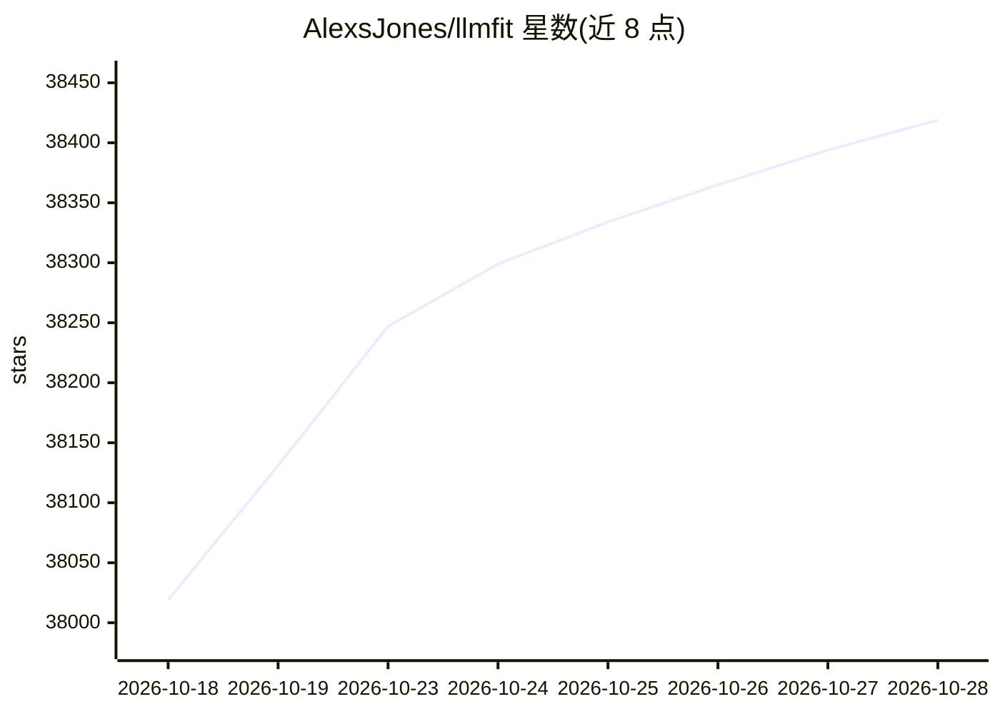

# AlexsJones/llmfit

⭐ 38,419 · Rust · MIT · 推送 2026-10-27 · [GitHub](https://github.com/AlexsJones/llmfit) · 个人维护

**检测本机硬件并推荐可流畅运行的本地 LLM 的命令行工具**

Rust 编写的终端工具：自动检测 CPU、内存、GPU/VRAM 与加速器配置，对模型目录中的模型按内存占用、预估速度、质量与上下文四维打分，推荐适配当前硬件的量化版本。支持 GGUF/AWQ/GPTQ/EXL2 量化格式、多 GPU 与 MoE 架构、硬件模拟，提供交互式 TUI、经典 CLI、Web UI 与 REST API。社区基准数据可通过 PR 回传，合并后同硬件用户可看到实测数值。安装途径覆盖 Scoop/Homebrew/MacPorts/安装脚本/uv/pip/预编译二进制/Docker/源码编译。

## 筛选速览

| 维度 | 判定 | 备注 |
|---|---|---|
| AI 角色 | `ai-ecosystem` | LLM/agent 周边工具 |
| 许可风险 | `permissive` | MIT |
| 部署形态 | `desktop` | 安装包/桌面程序 |
| 模型依赖 | — | README 未给出锁定关系 |
| 硬件要求 | — | 无带数字的原话,不猜 |
| 安装摩擦 | `low` | 无编译、无系统依赖或容器化 |
| 成熟度 | — | 结构信号不足 |

## 动量与使用信号

- 维护:`active` — 距上次 push 1.1 天,年发版 100,158 位贡献者
- 涨星:近 1 天 **+48**(自 20261016 起算)
- 下载:GitHub Release 附件 累计 376,246(100 个 release)
- 平台:WINDOWS / MACOS / LINUX · 协议:OLLAMA

## 能力要点

- 硬件自动检测：CPU、内存、GPU/VRAM、统一内存架构（CUDA/Apple Silicon/ROCm/OneAPI）
- 兼容性引擎：分析参数量、上下文长度与量化格式，投影内存占用与 tok/s
- TUI/CLI/Web UI/REST API 多种形态，支持脚本与 agent 消费 JSON 输出
- 社区基准共享：实测 tok/s 经 PR 合并后替代估算值

## 适用场景

- 挑选能在自己电脑上流畅运行的本地模型
- 为自动化部署流水线提供硬件适配的模型清单
- 对比不同硬件配置下的模型运行方案

## 场景标签

 · 领域:LLM 基础设施/本地部署工具

## 证据(README 行号)

> L16: Find out which open-source Large Language Models (LLMs) your hardware can comfortably run. `llmfit` inspects your C
> L25: - **Model Compatibility Engine**: Analyzes model parameter counts, context lengths, and quantization formats (GGUF,
> L27: - **REST API Endpoint**: Exposes standard HTTP JSON endpoints (`/api/v1/system`, `/api/v1/models`) for integration 

## 星数曲线

2026-10-18 38,019 → 2026-10-28 38,419（+400）

---
*卡片 v1 · prompt 1.4 · 生成 2026-10-18 · 置信度 high · 依据 README sha `f5f453d75543` · [字段定义](../../DATASET.md)*
