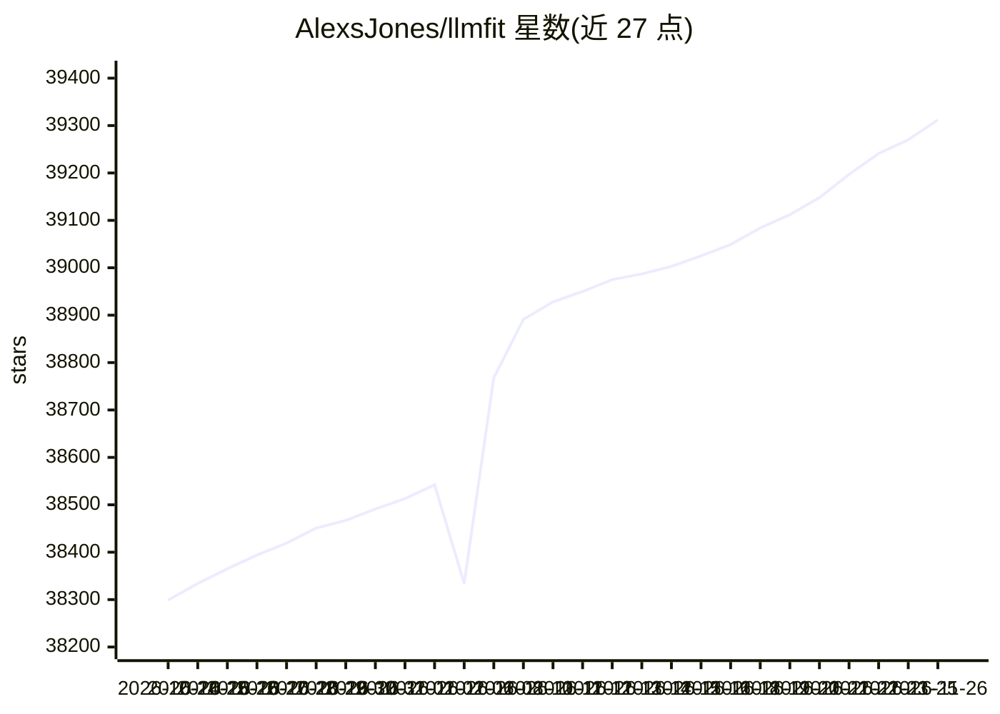

# AlexsJones/llmfit

⭐ 39,312 · Rust · MIT · 推送 2026-11-25 · [GitHub](https://github.com/AlexsJones/llmfit) · 个人维护

**为本地用户检测硬件并推荐可运行的 LLM 模型**

Rust 编写的终端工具：检测 CPU、内存、GPU/VRAM 等硬件配置，对模型目录中的数百个开源 LLM 按内存占用、速度、质量、上下文四个维度评分，推荐当前硬件可运行的模型与量化格式。提供交互式 TUI、经典 CLI、Web 仪表盘与 REST API，支持多 GPU、MoE 架构、本地运行时查询与社区基准数据回传，可通过 Docker 部署为无头服务。支持 Windows/macOS/Linux 多平台安装。

## 筛选速览

| 维度 | 判定 | 备注 |
|---|---|---|
| AI 角色 | `ai-ecosystem` | LLM/agent 周边工具 |
| 许可风险 | `permissive` | MIT |
| 部署形态 | `desktop` | 安装包/桌面程序 |
| 模型依赖 | local-ok | 支持本地模型 |
| 硬件要求 | — | 无带数字的原话,不猜 |
| 安装摩擦 | `low` | 无编译、无系统依赖或容器化 |
| 成熟度 | — | 结构信号不足 |

## 动量与使用信号

- 维护:`active` — 距上次 push 1.1 天,年发版 100,158 位贡献者
- 涨星:近 1 天 **+48**(自 20261016 起算)
- 下载:GitHub Release 附件 累计 376,246(100 个 release)
- 平台:WINDOWS / MACOS / LINUX · 协议:OLLAMA

## 能力要点

- 硬件自动检测（CUDA、Apple Silicon、ROCm、OneAPI）并按 fit/speed/quality/context 评分推荐模型
- 交互式 TUI 与 REST API（/api/v1/system、/api/v1/models）双形态
- 社区基准共享：实测 tok/s 数据通过 PR 回传并随版本发布
- Ray 集群模式：检查模型在多机间的切分可行性

## 适用场景

- 为本地推理环境挑选匹配显存/内存的模型
- 部署前用硬件模拟功能规划配置
- 在 Ray 多机集群上判断模型能否拆分运行

## 场景标签

 · 领域:LLM 基础设施/本地推理辅助

## 证据(README 行号)

> L17: Find out which open-source Large Language Models (LLMs) your hardware can comfortably run. `llmfit` inspects your C
> L28: - **REST API Endpoint**: Exposes standard HTTP JSON endpoints (`/api/v1/system`, `/api/v1/models`) for integration 
> L32: A terminal tool that right-sizes LLM models to your system's RAM, CPU, and GPU. Detects your hardware, scores each 

## 星数曲线

2026-10-24 38,299 → 2026-11-26 39,312（+1,013）

---
*卡片 v1 · prompt 1.4 · 生成 2026-11-24 · 置信度 high · 依据 README sha `fc33ce103ce0` · [字段定义](../../DATASET.md)*
