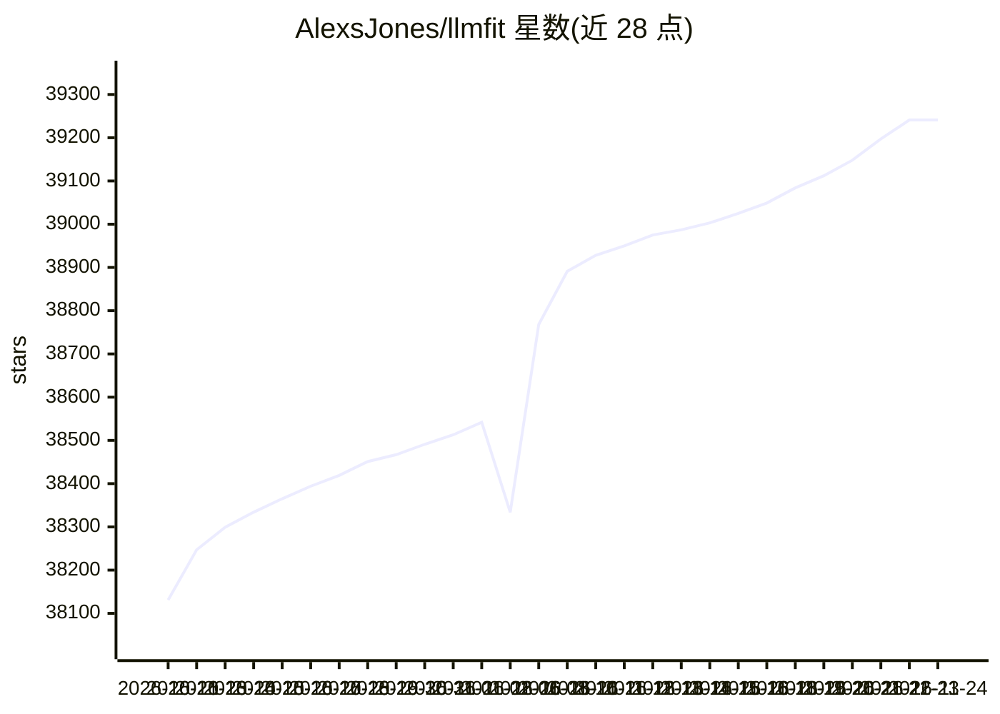

# AlexsJones/llmfit

⭐ 39,241 · Rust · MIT · 推送 2026-11-18 · [GitHub](https://github.com/AlexsJones/llmfit) · 个人维护

**检测本机硬件并推荐可流畅运行的开源 LLM**

llmfit 是一个 Rust 编写的终端工具，检测 CPU、内存、GPU/VRAM 与加速器配置后，对模型目录中的模型按显存占用、估计速度、质量与上下文长度打分，推荐适合本机运行的量化版本。提供交互式 TUI 与 CLI 模式，支持多 GPU、MoE 架构与本地运行时（Ollama、llama.cpp、MLX 等）；带 REST API/Web 界面供编排与自动化流程集成，用户可提交真实基准数据替换估算值。集群模式可读取 Ray dashboard 分析多机部署可行性。

## 筛选速览

| 维度 | 判定 | 备注 |
|---|---|---|
| AI 角色 | `ai-ecosystem` | LLM/agent 周边工具 |
| 许可风险 | `permissive` | MIT |
| 部署形态 | `desktop` | 安装包/桌面程序 |
| 模型依赖 | local-ok | 支持本地模型 |
| 硬件要求 | — | 无带数字的原话,不猜 |
| 安装摩擦 | `low` | 无编译、无系统依赖或容器化 |
| 成熟度 | — | 结构信号不足 |

## 动量与使用信号

- 维护:`active` — 距上次 push 1.1 天,年发版 100,158 位贡献者
- 涨星:近 1 天 **+48**(自 20261016 起算)
- 下载:GitHub Release 附件 累计 376,246(100 个 release)
- 平台:WINDOWS / MACOS / LINUX · 协议:OLLAMA

## 能力要点

- 自动检测 CPU/RAM/GPU/VRAM 及 NVIDIA CUDA、Apple Silicon、AMD ROCm、Intel OneAPI 配置
- 按 fit/speed/quality/context 四维度对模型评分，覆盖 GGUF、AWQ、GPTQ、EXL2 量化格式
- 提供 TUI、CLI、Web UI 与 REST API（/api/v1/system、/api/v1/models）多种使用方式
- 社区基准测试：真实 tok/s 测量可经 TUI 以 PR 提交，替换估算值

## 适用场景

- 本地部署前确认哪些开源模型能在自己的硬件上跑
- 通过 TUI 模拟不同硬件配置规划部署
- 在多机 Ray/vLLM 集群上检查模型是否可拆分运行
- 为自动化部署流水线提供硬件与模型匹配的 JSON 接口

## 场景标签

 · 领域:LLM 基础设施/本地推理选型

## 证据(README 行号)

> L16: Find out which open-source Large Language Models (LLMs) your hardware can comfortably run. `llmfit` inspects your C
> L33: Ships with an interactive TUI (default) and a classic CLI mode. Supports multi-GPU setups, MoE architectures, dynam

## 星数曲线

2026-10-21 38,131 → 2026-11-24 39,241（+1,110）

---
*卡片 v1 · prompt 1.4 · 生成 2026-11-22 · 置信度 high · 依据 README sha `f49472fa7179` · [字段定义](../../DATASET.md)*
