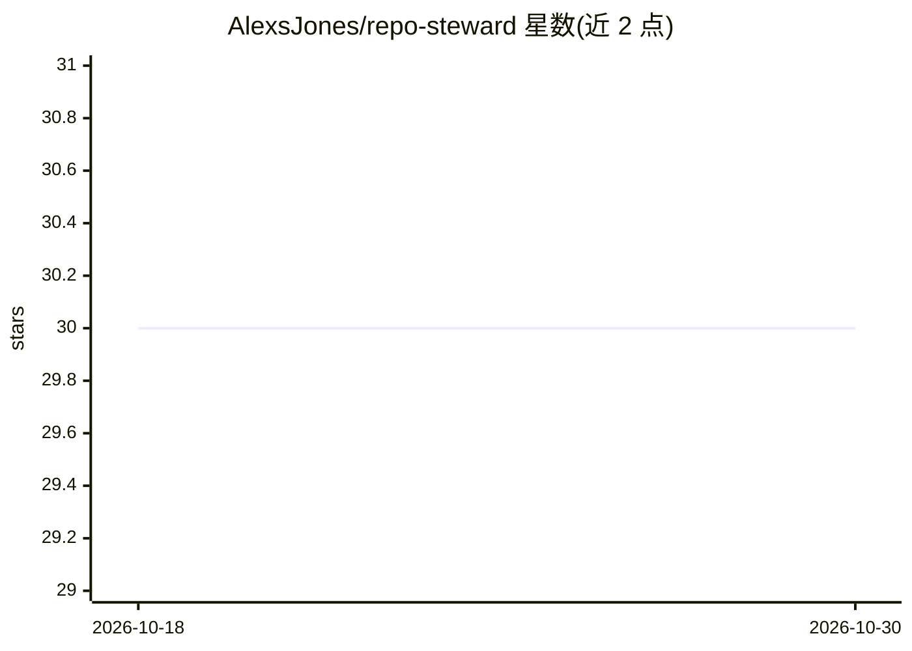

# AlexsJones/repo-steward

⭐ 30 · Python · MIT · 推送 2026-10-15 · [GitHub](https://github.com/AlexsJones/repo-steward) · 个人维护

**开源仓库维护的自主 agent：分诊 issue、审 PR、盯站点，仅升级关键决策**

面向开源维护者的仓库运营代理：以定时 tick 或手动触发方式分诊 issue、跨多轮迭代审查 PR、参与讨论、编写 bug-fix PR 并监控项目网站。默认草稿模式，所有审查与回复先暂存待批准；合并/关闭须由用户在仪表盘操作并使用用户自己的 GitHub 凭据。引擎采用无头编码代理 CLI（默认 Claude Code，可选 Codex/Gemini/opencode 等，支持经 opencode 接 Ollama/LM Studio 本地模型）。运行于 Linux systemd 用户会话，提供 Web 仪表盘与审计日志。非 Claude 引擎的权限拒绝层与 token/成本统计为部分限制。

## 筛选速览

| 维度 | 判定 | 备注 |
|---|---|---|
| AI 角色 | `ai-ecosystem` | LLM/agent 周边工具 |
| 许可风险 | `permissive` | MIT |
| 部署形态 | `None` |  |
| 模型依赖 | local-ok | 支持本地模型 |
| 硬件要求 | — | 无带数字的原话,不猜 |
| 安装摩擦 | `low` | 无编译、无系统依赖或容器化 |
| 成熟度 | — | 结构信号不足 |

## 能力要点

- 默认草稿模式，动作暂存待批准，合并须用户凭据点击执行
- Insights 扫描按价值/就绪度/工作量排序 issue，可一键实现并开 PR
- 可插拔引擎：Claude Code/Codex/Gemini/opencode，opencode 可接 Ollama 本地模型
- 进度与 ETA 基于磁盘工件与 GitHub 事实计算，不依赖模型自报

## 适用场景

- 维护者让 agent 日常分诊 issue 与迭代审查 PR，只处理升级上来的决策
- 自动监控项目网站可用性并在仪表盘汇总
- 对高价值 issue 一键让 agent 实现修复并提交 PR

## 场景标签

`编码 Agent` `代码审查` · 领域:编码与开发

## 证据(README 行号)

> L10: Repo Steward is an agent that runs the operational side of maintaining
> L148: The tick is an *agentic session* — it runs `gh`, edits ledgers, writes files —
> L156: STEWARD_ENGINE=opencode STEWARD_MODEL=ollama/qwen3 ./install.sh   # local models

## 星数曲线

2026-10-18 30 → 2026-10-30 30（+0）

---
*卡片 v1 · prompt 1.4 · 生成 2026-10-26 · 置信度 high · 依据 README sha `de9469da8663` · [字段定义](../../DATASET.md)*
