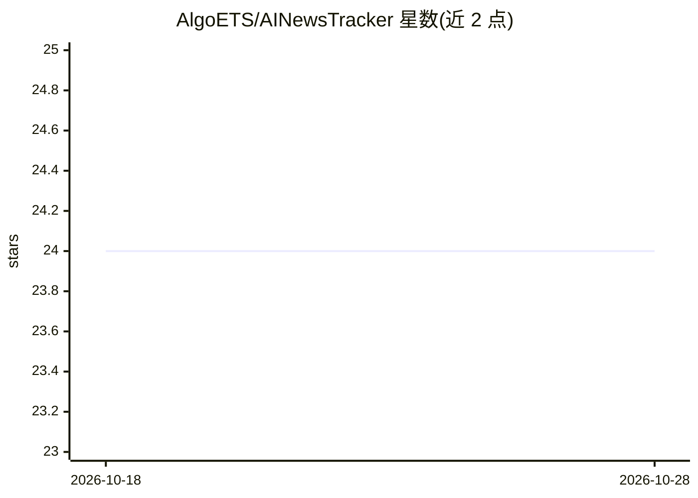

# AlgoETS/AINewsTracker

⭐ 24 · Python · MIT · 推送 2026-10-26 · [GitHub](https://github.com/AlgoETS/AINewsTracker) · [官网](https://algoets.github.io/AINewsTracker/) · 组织维护

**用 AI 分析财经新闻对股市影响的回测 Web 应用**

基于 FastAPI、MongoDB 的 Python Web 应用：从 60 多个国际与地区新闻源实时聚合财经新闻，用 AI 做情感分析、主题预测与股票代码分配，并提供回测功能以检验历史新闻对市场行为的影响与预测模型。安装走 Poetry 管理依赖，支持 uvicorn 开发模式启动与 docker-compose 部署，API 文档在本地端点提供。TODO 列表显示用户认证、分页、多语言等功能尚未实现。

## 筛选速览

| 维度 | 判定 | 备注 |
|---|---|---|
| AI 角色 | `ai-native` | 本体是模型或模型工具 |
| 许可风险 | `permissive` | MIT |
| 部署形态 | `self-host` | docker 或自建部署 |
| 模型依赖 | — | README 未给出锁定关系 |
| 硬件要求 | — | 无带数字的原话,不猜 |
| 安装摩擦 | `low` | 无编译、无系统依赖或容器化 |
| 成熟度 | — | 结构信号不足 |

## 能力要点

- 聚合 60 多个国际与地区新闻源的实时财经新闻
- AI 情感分析、主题预测与 tickers 分配
- 历史新闻对市场影响的回测能力
- FastAPI + MongoDB + Docker 技术栈，含 API 文档端点

## 适用场景

- 跟踪多源财经新闻并获取 AI 情感与主题分析
- 回测历史新闻对股价的影响以验证预测模型
- 按公司查询相关新闻数据（API 端点）

## 场景标签

`金融量化` · 领域:学习与行业

## 证据(README 行号)

> L17: AINewsTracker is a sophisticated web application that backtests the influence of financial news on the stock market
> L22: - **AI-based analysis**: Leverage artificial intelligence for sentiment analysis, topic prediction, and tickers all

## 星数曲线

2026-10-18 24 → 2026-10-28 24（+0）

---
*卡片 v1 · prompt 1.4 · 生成 2026-10-27 · 置信度 mid · 依据 README sha `b46bbe8a7dd3` · [字段定义](../../DATASET.md)*
