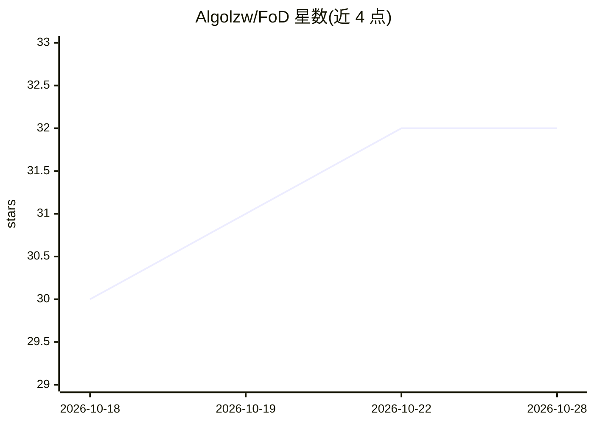

# Algolzw/FoD

⭐ 32 · Python · MIT · 推送 2026-10-02 · [GitHub](https://github.com/Algolzw/FoD) · [官网](https://algolzw.github.io/fod) · 个人维护

**FoD：状态相关前向扩散模型的图像修复与无条件生成官方实现**

TMLR 2026 论文 FoD（State-Dependent Forward Diffusion）的官方 PyTorch 实现，提供图像修复（去雨等任务，可替换数据集扩展到其他问题）与 CIFAR-10 无条件生成两条路径：训练脚本、采样脚本、多 GPU 并行采样（torchrun）与 FID/Inception Score 评测。核心算法位于 fod_diffusion.py，基于 DiT 与 guided-diffusion 代码。要求 Ubuntu 20.04、CUDA 12.2、Python 3.11，需 NVIDIA GPU 运行。无预训练模型分发说明，需自行训练。

## 筛选速览

| 维度 | 判定 | 备注 |
|---|---|---|
| AI 角色 | `ai-native` | 本体是模型或模型工具 |
| 许可风险 | `permissive` | MIT |
| 部署形态 | `library` | 以包/库形式分发 |
| 模型依赖 | — | README 未给出锁定关系 |
| 硬件要求 | — | 无带数字的原话,不猜 |
| 安装摩擦 | `medium` | 含编译或系统依赖之一 |
| 成熟度 | — | 结构信号不足 |

## 能力要点

- 图像修复训练/评测脚本（以去雨为例，可换数据集）
- CIFAR-10 无条件生成训练与并行采样脚本
- FID/Inception Score 评测脚本
- 核心状态相关前向扩散算法实现于 fod_diffusion.py

## 适用场景

- 复现论文中的图像去雨/修复实验
- 基于 FoD 扩散过程做图像生成研究
- 对比扩散模型前向过程的学术研究

## 场景标签

`图像生成` `模型训练` `图像视频处理` · 领域:内容生成

## 证据(README 行号)

> L1: ## Efficient Image Restoration with State-Dependent Forward Diffusion (FoD) Official PyTorch Implementation
> L27: ### Image Restoration

## 星数曲线

2026-10-18 30 → 2026-10-28 32（+2）

---
*卡片 v1 · prompt 1.4 · 生成 2026-10-26 · 置信度 mid · 依据 README sha `cdaf83fbf0dd` · [字段定义](../../DATASET.md)*
