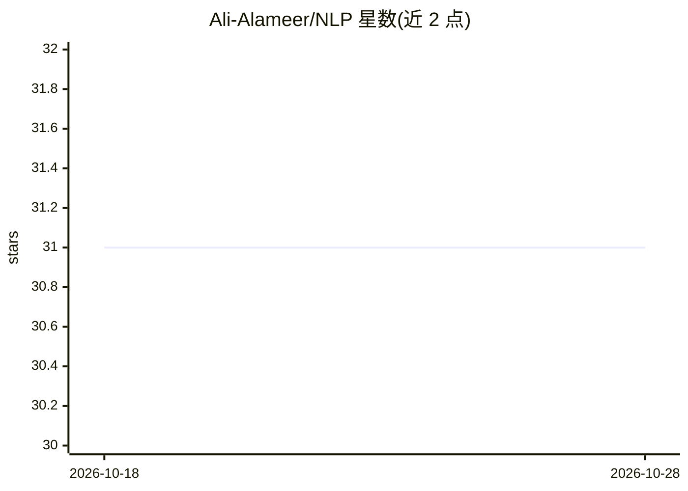

# Ali-Alameer/NLP

⭐ 31 · Jupyter Notebook · MIT · 推送 2026-05-12 · [GitHub](https://github.com/Ali-Alameer/NLP) · 个人维护

**基于 Keras/TensorFlow 的 NLP 教程与资源集合**

汇集自然语言处理教程、方法与工作坊代码的仓库，主题覆盖文本分类、语言建模与情感分析，代码使用 Keras 和 TensorFlow 编写并带注释。面向学生及 NLP 学习者，通过真实示例帮助理解技术原理。获取方式为下载 ZIP 或 git clone 克隆到本地运行。

## 筛选速览

| 维度 | 判定 | 备注 |
|---|---|---|
| AI 角色 | `ai-knowledge` | 知识聚合/清单类 |
| 许可风险 | `permissive` | MIT |
| 部署形态 | `None` |  |
| 模型依赖 | — | README 未给出锁定关系 |
| 硬件要求 | — | 无带数字的原话,不猜 |
| 安装摩擦 | `low` | 无编译、无系统依赖或容器化 |
| 成熟度 | — | 结构信号不足 |

## 能力要点

- 覆盖文本分类、语言建模、情感分析等 NLP 主题
- 基于 Keras/TensorFlow 编写，代码含注释
- 提供可跟随操作的工作坊（workshops）内容

## 适用场景

- 学习 NLP 基础技术并通过示例代码动手实验
- 课程或自学场景下获取文本分类与情感分析实践材料

## 场景标签

`教程课程` · 领域:学习与行业

## 证据(README 行号)

> L2: This GitHub repository is a collection of resources and tutorials for Natural Language Processing (NLP) using the po

## 星数曲线

2026-10-18 31 → 2026-10-28 31（+0）

---
*卡片 v1 · prompt 1.4 · 生成 2026-10-26 · 置信度 high · 依据 README sha `1de787aff97b` · [字段定义](../../DATASET.md)*
