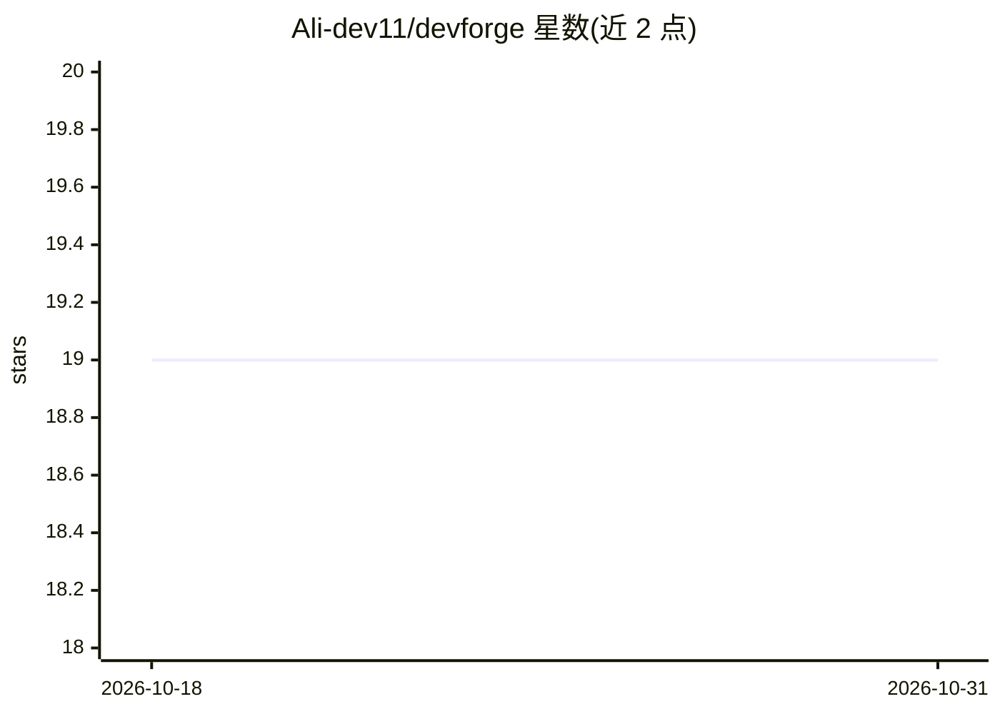

# Ali-dev11/devforge

⭐ 19 · TypeScript · MIT · 推送 2026-06-29 · [GitHub](https://github.com/Ali-dev11/devforge) · [官网](https://ali-dev11.github.io/devforge/) · 个人维护

**面向 JS/TS 团队的项目脚手架 CLI，一键生成可用仓库**

交互式脚手架命令行工具：通过引导式问答确定项目意图、技术栈与架构，输出包含启动界面、测试配置、文档、仓库规范的可用仓库，覆盖前端、后端 API、全栈、微前端、Chrome 扩展与 CLI 工具等形态。特色包括生成面向 Cursor、Claude、Codex 的 AI 规则文件与 AGENTS.md，校验无效技术栈组合，提供 config-as-code、预设与 add/upgrade 命令管理后续功能。部署基线覆盖 Vercel、Netlify、Render、Railway 与 Docker Compose，通过 npx 免全局安装运行。

## 筛选速览

| 维度 | 判定 | 备注 |
|---|---|---|
| AI 角色 | `ai-enhanced` | 去掉 AI 部分产品仍成立 |
| 许可风险 | `permissive` | MIT |
| 部署形态 | `self-host` | docker 或自建部署 |
| 模型依赖 | — | README 未给出锁定关系 |
| 硬件要求 | — | 无带数字的原话,不猜 |
| 安装摩擦 | `low` | 无编译、无系统依赖或容器化 |
| 成熟度 | — | 结构信号不足 |

## 能力要点

- 引导式问答生成含文档/测试/CI 选项的可运行仓库
- 生成 Cursor/Claude/Codex 的 AI 规则文件与 AGENTS.md
- 校验无效技术栈组合，提供 config-as-code 与预设复用
- add/upgrade 命令后续添加测试、Docker、CI 并保守刷新托管文件

## 适用场景

- 团队快速从想法生成规范化可运行项目
- 统一个人项目、内部工具与客户项目的脚手架标准
- 让 Cursor/Claude/Codex 等 AI 工具与选定技术栈保持一致

## 场景标签

`代码生成` · 领域:编码与开发

## 证据(README 行号)

> L3: DevForge CLI is an AI-native scaffolding tool for JavaScript and TypeScript teams that want more than a blank starte
> L22: - AI rule outputs for Cursor, Claude, Codex, and `AGENTS.md`

## 星数曲线

2026-10-18 19 → 2026-10-31 19（+0）

---
*卡片 v1 · prompt 1.4 · 生成 2026-10-29 · 置信度 low · 依据 README sha `76917d1fa1e8` · [字段定义](../../DATASET.md)*
