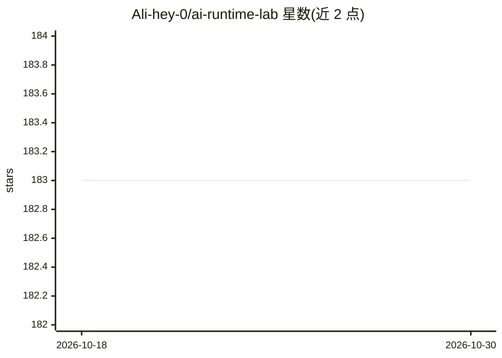

# Ali-hey-0/ai-runtime-lab

⭐ 183 · Python · 推送 2026-07-20 · [GitHub](https://github.com/Ali-hey-0/ai-runtime-lab) · 个人维护 · 中文 README

**面向工程师的 agentic AI 系统工程教学实验室：14 个可运行概念验证**

个人工程教育项目，非框架非 API 封装：以渐进式课程组织 14 个阶段，每阶段一个 30–100 行的可运行参考实现，覆盖 FSM 状态控制、持久化执行、重试与幂等、DAG 并行、Agent 运行时、模型路由、边缘推理、RAG、记忆、多智能体编排、安全与可观测性。核心机制为“LLM 只提议意图，确定性运行时负责执行”，每个转换同步落盘检查点以支持崩溃恢复。供希望掌握 agent 系统底层原语的工程师学习。

## 筛选速览

| 维度 | 判定 | 备注 |
|---|---|---|
| AI 角色 | `ai-knowledge` | 知识聚合/清单类 |
| 许可风险 | `none` | — |
| 部署形态 | `None` |  |
| 模型依赖 | — | README 未给出锁定关系 |
| 硬件要求 | — | 无带数字的原话,不猜 |
| 安装摩擦 | `low` | 无编译、无系统依赖或容器化 |
| 成熟度 | — | 结构信号不足 |

## 能力要点

- 14 个自包含可运行的概念验证阶段，每概念 30–100 行代码
- FSM→意图校验→持久幂等执行→检查点→观测的运行时模式
- Workflow/Activity 分离的崩溃恢复与重放（Memoization）机制
- 覆盖幂等键、退避抖动、DAG 并行、模型路由、沙箱安全等主题

## 适用场景

- 系统化学习生产级 agentic AI 系统的架构原语
- 理解 Temporal/LangGraph 等框架在重实现哪些底层机制
- 为自研 agent 运行时寻找各阶段参考实现

## 场景标签

`教程课程` · 领域:学习与行业

## 证据(README 行号)

> L5: *A hands-on curriculum and reference implementation for building production-grade agentic AI systems — from state ma
> L25: Every folder here is a self-contained, minimal, runnable proof-of-concept for one architectural concern in agentic 
> L27: This is a personal engineering-education project, structured as a progressive curriculum with runnable reference co

## 星数曲线

2026-10-18 183 → 2026-10-30 183（+0）

---
*卡片 v1 · prompt 1.4 · 生成 2026-10-22 · 置信度 high · 依据 README sha `f1076b3f836f` · [字段定义](../../DATASET.md)*
