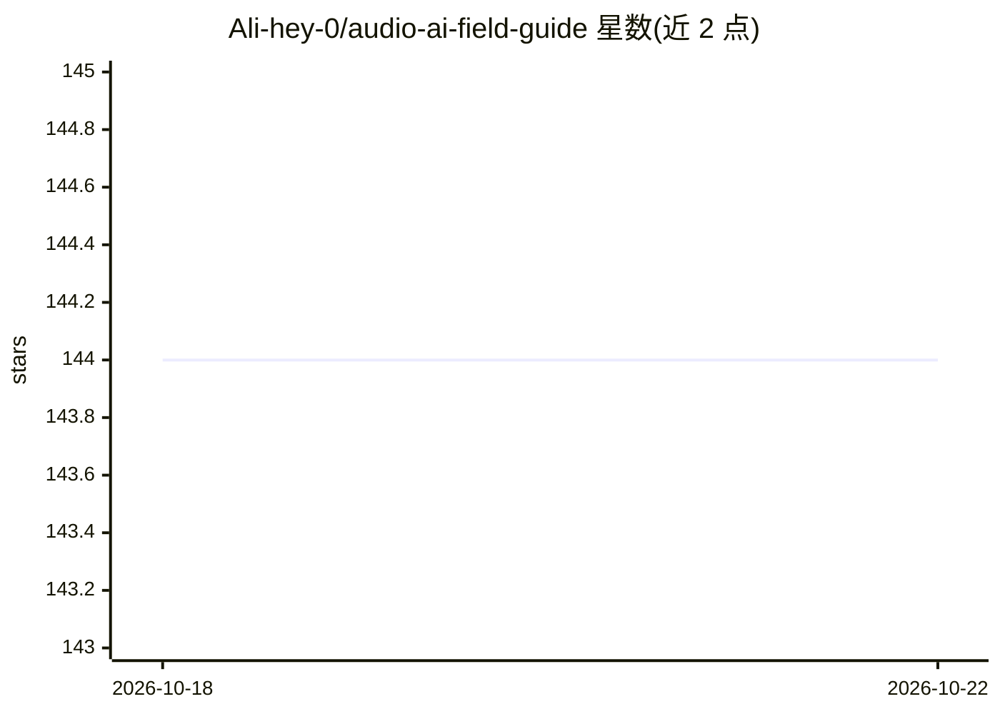

# Ali-hey-0/audio-ai-field-guide

⭐ 144 · MIT · 推送 2026-07-16 · [GitHub](https://github.com/Ali-hey-0/audio-ai-field-guide) · [官网](https://huggingface.co/learn/audio-course) · 个人维护

**音频 AI 心智模型参考指南：从波形到语音系统全流程**

面向已掌握 NLP/CV Transformer 的读者的音频机器学习学习笔记：以心智模型组织内容，覆盖数据集加载与预处理（重采样、流式读取）、七类音频任务（ASR、音频分类、说话人识别、情感识别、TTS、音频生成、语音翻译）、Transformer 架构与微调、语音助手/会议转写等实际管线。强调 NLP 知识向音频领域的迁移映射，双语（英/波斯语）。内容为参考文档，不含可运行的本体代码工程。

## 筛选速览

| 维度 | 判定 | 备注 |
|---|---|---|
| AI 角色 | `ai-knowledge` | 知识聚合/清单类 |
| 许可风险 | `permissive` | MIT |
| 部署形态 | `library` | 以包/库形式分发 |
| 模型依赖 | — | README 未给出锁定关系 |
| 硬件要求 | — | 无带数字的原话,不猜 |
| 安装摩擦 | `low` | 无编译、无系统依赖或容器化 |
| 成熟度 | — | 结构信号不足 |

## 能力要点

- 以'五阶段骨架'心智模型统一解释各类音频 ML 系统
- NLP→音频的 Transformer 知识迁移映射表
- 覆盖七类音频任务及基于输出的对比表
- 数据集加载、重采样、流式读取等预处理细节与留存清单

## 适用场景

- 从 NLP 背景转入音频 AI 的学习者建立系统认知
- 查阅重采样/流式数据加载等预处理的原理与陷阱
- 了解 ASR/TTS/音频生成等任务族的区别与适用模型

## 场景标签

`教程课程` · 领域:学习与行业

## 证据(README 行号)

> L4: **A complete, mental-model-first reference for modern speech & audio machine learning**
> L6: *Datasets → Preprocessing → Transformer Architectures → ASR → Audio Classification → TTS → Real-World Pipelines*

## 星数曲线

2026-10-18 144 → 2026-10-22 144（+0）

---
*卡片 v1 · prompt 1.4 · 生成 2026-10-22 · 置信度 mid · 依据 README sha `e64e1e9a7d6a` · [字段定义](../../DATASET.md)*
