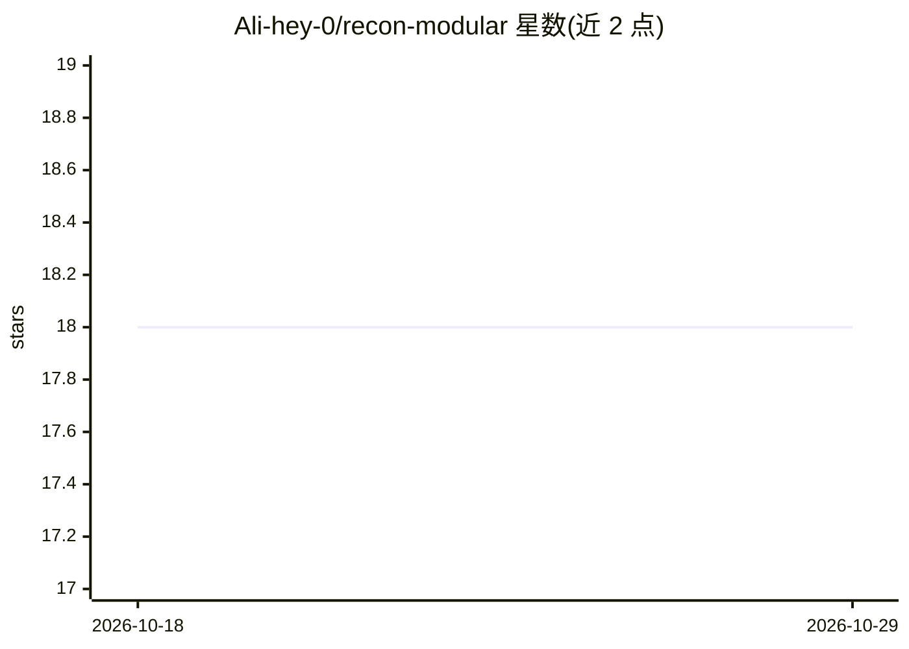

# Ali-hey-0/recon-modular

⭐ 18 · Shell · MIT · 推送 2026-07-16 · [GitHub](https://github.com/Ali-hey-0/recon-modular) · 个人维护

**面向授权安全测试的 Bash 侦察框架，统一调度 130+ 安全工具**

OMNISCIENT V3 是一个 Bash 编写的侦察与对抗模拟框架，将子域名枚举、漏洞扫描、云/IoT 侦察、暗网监控、供应链分析等 130+ 外部安全工具编排为 14 阶段并行流水线，面向漏洞赏金猎人、红队与 DevSecOps 工程师。AI 部分为增强分析：GAN 生成子域名排列、ML 端点预测、强化学习排序漏洞优先级。支持 Kubernetes/Lambda/Swarm 分布式执行、Kyber-1024 后量子加密、以太坊智能合约审计日志。仅限授权安全评估用途；需 Linux 环境，依赖 130+ 外部工具（脚本可自动安装），可选配置 Shodan 等十余种 API key。

## 筛选速览

| 维度 | 判定 | 备注 |
|---|---|---|
| AI 角色 | `ai-enhanced` | 去掉 AI 部分产品仍成立 |
| 许可风险 | `permissive` | MIT |
| 部署形态 | `library` | 以包/库形式分发 |
| 模型依赖 | — | README 未给出锁定关系 |
| 硬件要求 | `cpu-ok` | |
| 安装摩擦 | `medium` | 含编译或系统依赖之一 |
| 成熟度 | — | 结构信号不足 |

## 能力要点

- 14 阶段并行侦察流水线，统一 130+ 安全工具
- GAN 子域名生成、ML 端点预测、强化学习漏洞优先级排序
- 区块链锚定审计日志与 NIST/GDPR/ISO 合规报告
- Tor/代理链/Kyber-1024 后量子加密的隐匿选项

## 适用场景

- 授权范围内的漏洞赏金目标侦察与漏洞扫描
- 红队演练中生成可审计的行动记录
- 云与容器资产的安全扫描及 SBOM 供应链分析

## 场景标签

`网络安全` · 领域:学习与行业

## 证据(README 行号)

> L37: - **Augmenting results with AI** – using GANs, reinforcement learning, and deep neural networks to predict subdomai
> L59: - **GAN‑powered subdomain permutations** – generate realistic, unseen subdomains

## 星数曲线

2026-10-18 18 → 2026-10-29 18（+0）

---
*卡片 v1 · prompt 1.4 · 生成 2026-10-29 · 置信度 mid · 依据 README sha `25cb2a2e0e11` · [字段定义](../../DATASET.md)*
