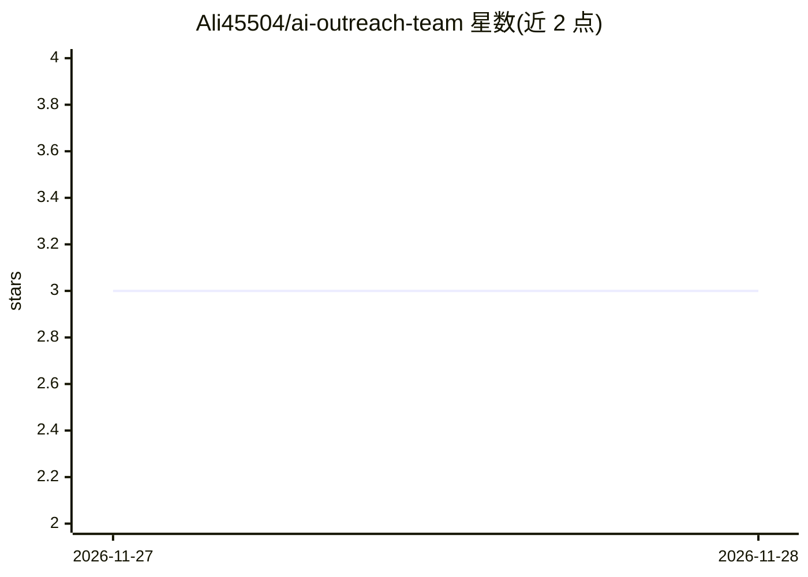

# Ali45504/ai-outreach-team

⭐ 3 · Python · 推送 2026-11-25 · [GitHub](https://github.com/Ali45504/ai-outreach-team) · [官网](https://shahmuhammadali.com) · 个人维护

**n8n 上的多 agent 邮件外联自动化工作流**

在 n8n 中构建的多 agent 邮件外联系统：从 Google Sheet 选取联系人，由 Copywriter 生成个性化邮件并经 Quality Critic 与 Senior Manager 审核后经 Gmail 逐封发送；Reply Handler 用免费 LLM 阅读回复并分类（报价、感兴趣、不感兴趣、退信等），抽取价格与联系方式，Recorder 回写表格并生成日报。每个 agent 配有 manager 检查器，未通过即拦截。作者自用于网红营销场景，含安装部署与商业配置服务说明。

## 筛选速览

| 维度 | 判定 | 备注 |
|---|---|---|
| AI 角色 | `ai-native` | 本体是模型或模型工具 |
| 许可风险 | `none` | — |
| 部署形态 | `None` |  |
| 模型依赖 | locked-api |  |
| 硬件要求 | — | 无带数字的原话,不猜 |
| 安装摩擦 | `low` | 无编译、无系统依赖或容器化 |
| 成熟度 | — | 结构信号不足 |

## 能力要点

- 5 个 agent 各配 manager 检查器，全部通过才发送
- Reply Handler 用免费模型（Groq/Gemini/Cerebras）分类回复并抽取报价与联系方式
- 价格仅在回复原文逐字出现时才记录，截图类回复转人工
- 每日限额（25 封新邮件、每域名最多 2 封）与错误告警工作流

## 适用场景

- 从表格管理网红/达人名单并自动化冷邮件外联
- 自动阅读 Gmail 回复并生成谈判草稿
- 在 Google Sheet 中自动维护外联状态与团队记忆

## 场景标签

`多智能体` `工作流自动化` · 领域:Agent 开发

## 证据(README 行号)

> L5: A team of AI agents built in **n8n** that runs **email outreach** end to end: it picks who to contact
> L18: 2. **Reply Handler** reads every new reply with a free AI model, sorts it (rates sent, interested,
> L23: 5. **Copywriter** writes each email; the **Quality Critic** blocks risky phrases, links and rule breaks.

## 星数曲线

2026-11-27 3 → 2026-11-28 3（+0）

---
*卡片 v1 · prompt 1.4 · 生成 2026-11-27 · 置信度 high · 依据 README sha `3faa90986345` · [字段定义](../../DATASET.md)*
