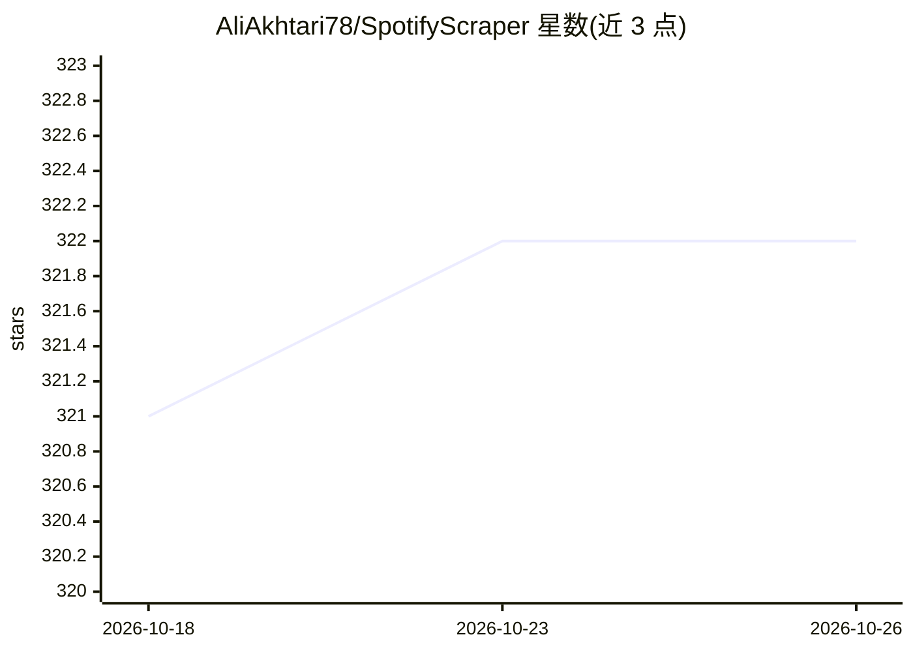

# AliAkhtari78/SpotifyScraper

⭐ 322 · Python · MIT · 推送 2026-09-18 · [GitHub](https://github.com/AliAkhtari78/SpotifyScraper) · [官网](https://spotifyscraper.readthedocs.io/en/latest) · 个人维护

**免 API key 抓取 Spotify 公开数据的 Python 库**

通过 Spotify 公开 embed 页面引导匿名 token，读取网页播放器同源的 JSON 端点，返回类型化的不可变模型；覆盖曲目、专辑、艺人、播放列表、播客、歌词与播客转录（后者需自备 sp_dc cookie，非密码或 API key）。提供同步与异步客户端、CLI、批量 helper、响应缓存、Playwright 浏览器回退与登录，另含面向 Claude/LLM agent 的 MCP server（亦可容器运行）。仅依赖 httpx；不下载完整音轨、不绕过 DRM。官方 API 于 2024 年 11 月对新建应用限制的 related-artists/recommendations 端点，本库仍可返回。

## 筛选速览

| 维度 | 判定 | 备注 |
|---|---|---|
| AI 角色 | `ai-enhanced` | 去掉 AI 部分产品仍成立 |
| 许可风险 | `permissive` | MIT |
| 部署形态 | `self-host` | docker 或自建部署 |
| 模型依赖 | — | README 未给出锁定关系 |
| 硬件要求 | — | 无带数字的原话,不猜 |
| 安装摩擦 | `low` | 无编译、无系统依赖或容器化 |
| 成熟度 | — | 结构信号不足 |

## 能力要点

- 无需 API key/app 注册，读取公开数据（含歌词与播客转录，需 sp_dc cookie）
- 同步与异步客户端共享同一 sans-io 核心，返回类型化冻结模型
- MCP server 暴露全部能力给 Claude/LLM agent，ghcr.io 容器分发
- 批量 helper 部分失败安全、可选持久化缓存、每日 canary 监控端点变更

## 适用场景

- 不注册 Spotify 开发者应用就抓取公开曲目/专辑/播放列表元数据
- 获取歌词、播客转录与 30 秒试听预览
- 让 Claude 等 LLM agent 通过 MCP 直接查询 Spotify 数据

## 场景标签

`网页抓取` · 领域:效率与自动化

## 证据(README 行号)

> L14: **Extract public Spotify data — tracks, albums, artists, playlists, and podcasts — without the official API or an A
> L128: - **MCP server** — expose everything to Claude/LLMs via `spotifyscraper-mcp` (batch tools + a one-call `get_track_

## 星数曲线

2026-10-18 321 → 2026-10-26 322（+1）

---
*卡片 v1 · prompt 1.4 · 生成 2026-10-22 · 置信度 high · 依据 README sha `0ee44b0252f5` · [字段定义](../../DATASET.md)*
