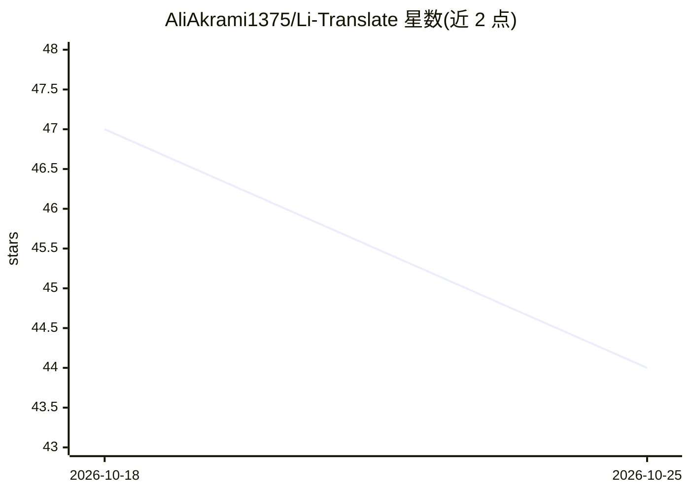

# AliAkrami1375/Li-Translate

⭐ 44 · Vue · 推送 2026-07-19 · [GitHub](https://github.com/AliAkrami1375/Li-Translate) · [官网](https://dibachain.ir/) · 个人维护

**自托管的 AI 视频字幕生成与多语言翻译工作室**

单页 Web 应用：在浏览器内用 ffmpeg.wasm 抽取并切分音频，上传后由服务端两个后台 agent 处理——转录 agent（Whisper 类模型，经 OpenRouter 的 OpenAI 兼容 API）产出带时间轴的字幕，翻译 agent（指令跟随 LLM）按 1:1 行映射翻译且复用原时间戳。结果持续写入 SQLite，刷新页面后任务自动恢复。内置时间轴字幕编辑器，支持多语言轨道并导出 SRT/VTT/ASS/TXT。需自备模型 API key，通过 npm 或 Docker 自托管部署。

## 筛选速览

| 维度 | 判定 | 备注 |
|---|---|---|
| AI 角色 | `ai-native` | 本体是模型或模型工具 |
| 许可风险 | `none` | — |
| 部署形态 | `self-host` | docker 或自建部署 |
| 模型依赖 | locked-api |  |
| 硬件要求 | — | 无带数字的原话,不猜 |
| 安装摩擦 | `low` | 无编译、无系统依赖或容器化 |
| 成熟度 | — | 结构信号不足 |

## 能力要点

- 浏览器内 ffmpeg.wasm 抽取音频（自托管，无 CDN），长音频分块处理
- 转录/翻译双 agent 架构，各自可配置独立模型
- 翻译 1:1 行映射，保留原字幕时间戳
- 后台任务状态持久化到 SQLite，刷新后自动恢复
- 导出 SRT/VTT/ASS/TXT，多语言轨道并行编辑

## 适用场景

- 给视频/音频生成带时间轴的字幕并翻译成其他语言
- 在时间轴编辑器中精修字幕断句、时间与样式
- 自托管部署一套字幕本地化工具，数据不出本机

## 场景标签

`语音识别` · 领域:感知与多模态

## 证据(README 行号)

> L17: LiTranslate turns any video or audio file into clean, time-aligned subtitles and then localizes
> L62: |**Model**|Whisper-class model, configurable via `TRANSCRIPTION_MODEL`|
> L86: |**Model**|Instruction-following LLM, configurable via `TRANSLATION_MODEL`|

## 星数曲线

2026-10-18 47 → 2026-10-25 44（-3）

---
*卡片 v1 · prompt 1.4 · 生成 2026-10-25 · 置信度 high · 依据 README sha `10a61561d466` · [字段定义](../../DATASET.md)*
