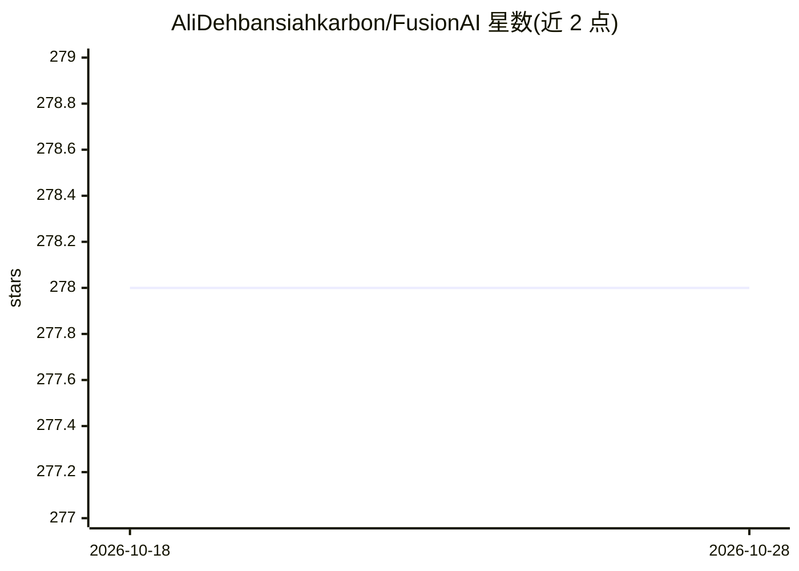

# AliDehbansiahkarbon/FusionAI

⭐ 278 · Pascal · MIT · 推送 2026-04-30 · [GitHub](https://github.com/AliDehbansiahkarbon/FusionAI) · [官网](https://alidehbansiahkarbon.github.io/FusionAI/) · 个人维护

**RAD Studio IDE 的多模型 AI 助手插件（ChatGPT/Gemini/Claude/Ollama）**

面向 Embarcadero RAD Studio 10.x 与 11.x 的 Delphi 插件（前身为 ChatGPTWizard），在 IDE 内提供 AI 辅助：聊天窗口提问、编辑器内联提示（cpt: ... :cpt 格式）、右键预定义动作（解释/优化/加注释/加测试/找 bug/转汇编等）、Class View 类型级提示，以及跨多家 AI 提供商的答案对比。支持 OpenAI ChatGPT、Google Gemini、Anthropic Claude 与本地 Ollama（无需云端 key）。历史记录存入本地 SQLite，可按提供商/模型过滤并支持模糊搜索。通过 Delphinus 或直接编译安装包安装；非 RAD Studio 12.2+ 的主要目标。

## 筛选速览

| 维度 | 判定 | 备注 |
|---|---|---|
| AI 角色 | `ai-ecosystem` | LLM/agent 周边工具 |
| 许可风险 | `permissive` | MIT |
| 部署形态 | `desktop` | 安装包/桌面程序 |
| 模型依赖 | local-ok | 支持本地模型 |
| 硬件要求 | — | 无带数字的原话,不猜 |
| 安装摩擦 | `low` | 无编译、无系统依赖或容器化 |
| 成熟度 | — | 结构信号不足 |

## 能力要点

- 同时支持 ChatGPT/Gemini/Claude/Ollama 并可对比多家答案
- 编辑器内联提示与右键代码动作（加测试/找 bug/优化/转汇编等）
- 基于本地 SQLite 的提供商感知历史库与模糊搜索
- Ollama 本地端点支持离线/私有工作流

## 适用场景

- 在 RAD Studio 中直接向 AI 提问并解释、重构代码
- 用本地 Ollama 模型做离线代码辅助
- 在多个 AI 提供商之间对比同一问题的回答
- 检索过去的 AI 对话历史

## 场景标签

`AI 助手` `代码生成` · 领域:编码与开发

## 证据(README 行号)

> L20: FusionAI is a Delphi plug-in for RAD Studio that brings AI-assisted workflows into the IDE:
> L52: FusionAI currently supports:

## 星数曲线

2026-10-18 278 → 2026-10-28 278（+0）

---
*卡片 v1 · prompt 1.4 · 生成 2026-10-22 · 置信度 high · 依据 README sha `82c38eb5d4ca` · [字段定义](../../DATASET.md)*
