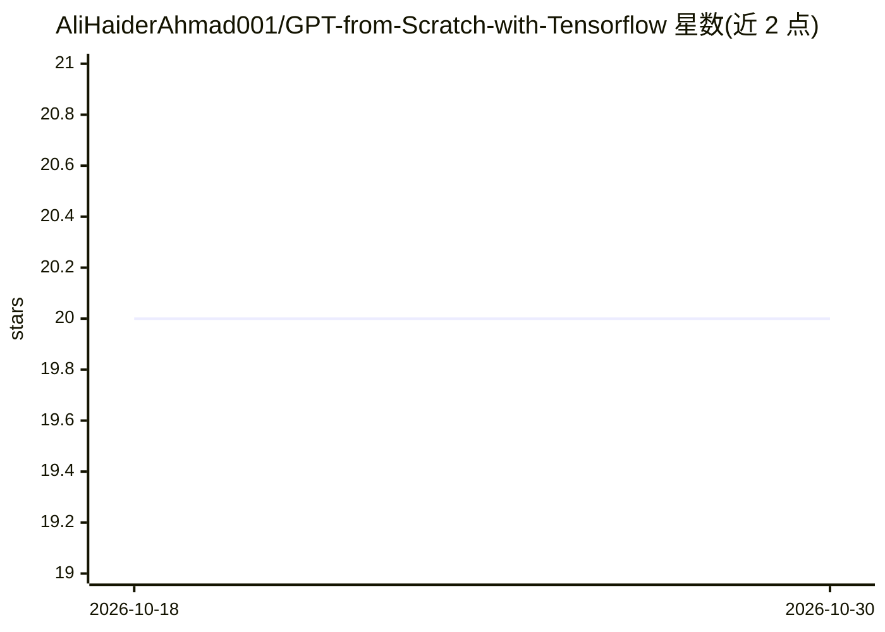

# AliHaiderAhmad001/GPT-from-Scratch-with-Tensorflow

⭐ 20 · Python · MIT · 推送 2026-03-12 · [GitHub](https://github.com/AliHaiderAhmad001/GPT-from-Scratch-with-Tensorflow) · 个人维护

**面向教学用途的 GPT-1 论文 TensorFlow 从零实现**

用 TensorFlow 逐组件实现 GPT 论文 "Improving Language Understanding by Generative Pre-Training"：包含多头自注意力、位置与词嵌入、前馈层、解码器、学习率调度、自定义损失与指标，以及 BPE 分词器和数据流式加载器。README 明确声明项目以教学理解为目的，数据集文件仅针对简单、非大规模数据设计，处理大数据需自行修改。提供从源码克隆安装、数据准备、分词器重训练、训练与推理（greedy/beam 采样）的完整命令流程。

## 筛选速览

| 维度 | 判定 | 备注 |
|---|---|---|
| AI 角色 | `ai-native` | 本体是模型或模型工具 |
| 许可风险 | `permissive` | MIT |
| 部署形态 | `library` | 以包/库形式分发 |
| 模型依赖 | — | README 未给出锁定关系 |
| 硬件要求 | — | 无带数字的原话,不猜 |
| 安装摩擦 | `low` | 无编译、无系统依赖或容器化 |
| 成熟度 | — | 结构信号不足 |

## 能力要点

- 按模块拆分实现 GPT 各组件（注意力/嵌入/前馈/解码器等）
- 支持从零训练与从 checkpoint 恢复训练
- 推理脚本支持 greedy 与 beam search 两种采样
- 可重训练 BPE 分词器，Transformers 仅用于 tokenizer

## 适用场景

- 逐步理解 GPT 架构各组件的实现方式
- 复用项目中的组件到自己的语言模型项目
- 小数据集上跑通 GPT 训练与文本生成流程

## 场景标签

`教程课程` `模型训练` · 领域:学习与行业

## 证据(README 行号)

> L13: This project is an implementation of the GPT (Generative Pre-trained Transformer) model from scratch using TensorFl
> L15: **Important Note:** The goal of this project is to provide a deep understanding of the GPT architecture and its inn
> L17: There are several versions of the GPT. This implementation focuses mainly on the implementation of "Improving Langu

## 星数曲线

2026-10-18 20 → 2026-10-30 20（+0）

---
*卡片 v1 · prompt 1.4 · 生成 2026-10-28 · 置信度 mid · 依据 README sha `48e7fcedf747` · [字段定义](../../DATASET.md)*
