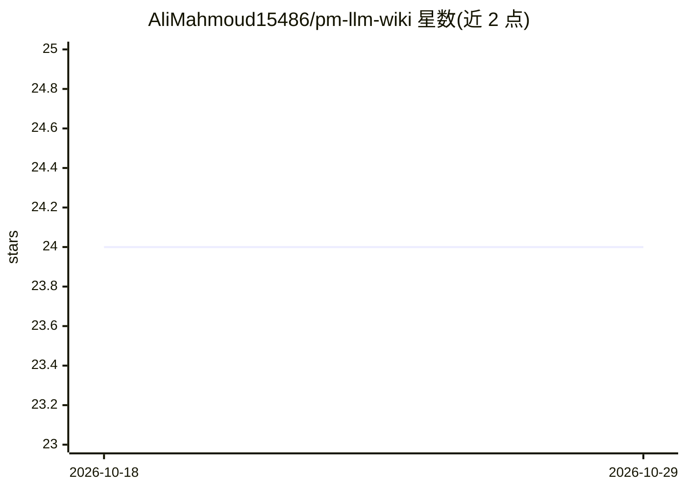

# AliMahmoud15486/pm-llm-wiki

⭐ 24 · NOASSERTION · 推送 2026-07-03 · [GitHub](https://github.com/AliMahmoud15486/pm-llm-wiki) · [官网](https://theglocalpm.com/blog-pm-llm-wiki.html) · 个人维护

**面向产品经理的 LLM 维护知识库模板：模式、schema 与仪式**

将 Karpathy 的 LLM Wiki 模式落地为产品管理版本：以一个 CLAUDE.md schema 文件驱动编码 agent（Claude Code 为参考工具，Codex 等亦可）维护记录问题、决策、假设与待解问题的 wiki。输入由用户人工筛选（访谈、反馈、分析、竞品情报等），agent 负责归档、交叉引用与更新；配合三项仪式（Ingest/Query/Lint）与五条诚信规则（证据链、写入门控、决策不删除等）。无需数据库或向量库，仅需文件夹与 agent 工具，附完整试点示例，MIT 许可。

## 筛选速览

| 维度 | 判定 | 备注 |
|---|---|---|
| AI 角色 | `ai-knowledge` | 知识聚合/清单类 |
| 许可风险 | `none` | NOASSERTION |
| 部署形态 | `None` |  |
| 模型依赖 | locked-api |  |
| 硬件要求 | — | 无带数字的原话,不猜 |
| 安装摩擦 | `low` | 无编译、无系统依赖或容器化 |
| 成熟度 | — | 结构信号不足 |

## 能力要点

- 单一 CLAUDE.md schema 将通用编码 agent 变成有纪律的 wiki 维护者
- 四类实体（问题/决策/假设/待解问题）+ 三项仪式（Ingest/Query/Lint）
- 证据链强制内联引用，无来源声明标记为 unsupported
- 决策与假设状态变更需人工审批（写入门控）

## 适用场景

- 让 agent 持续归档访谈与会议记录，积累产品知识
- 用积累的证据快速生成带引用的 PRD 与优先级排序
- 回答『当时为什么选 X 不选 Y』并保留完整决策链

## 场景标签

`知识库管理` · 领域:知识与检索

## 证据(README 行号)

> L15: To the best of our knowledge, **this is the first open-source instantiation of the LLM Wiki
> L75: - **The schema is the real product.** One file (`CLAUDE.md`) turns a generic chatbot into a
> L76:  disciplined wiki maintainer. Ours is template/SCHEMA.md — battle-tested

## 星数曲线

2026-10-18 24 → 2026-10-29 24（+0）

---
*卡片 v1 · prompt 1.4 · 生成 2026-10-27 · 置信度 mid · 依据 README sha `258cece97cb5` · [字段定义](../../DATASET.md)*
