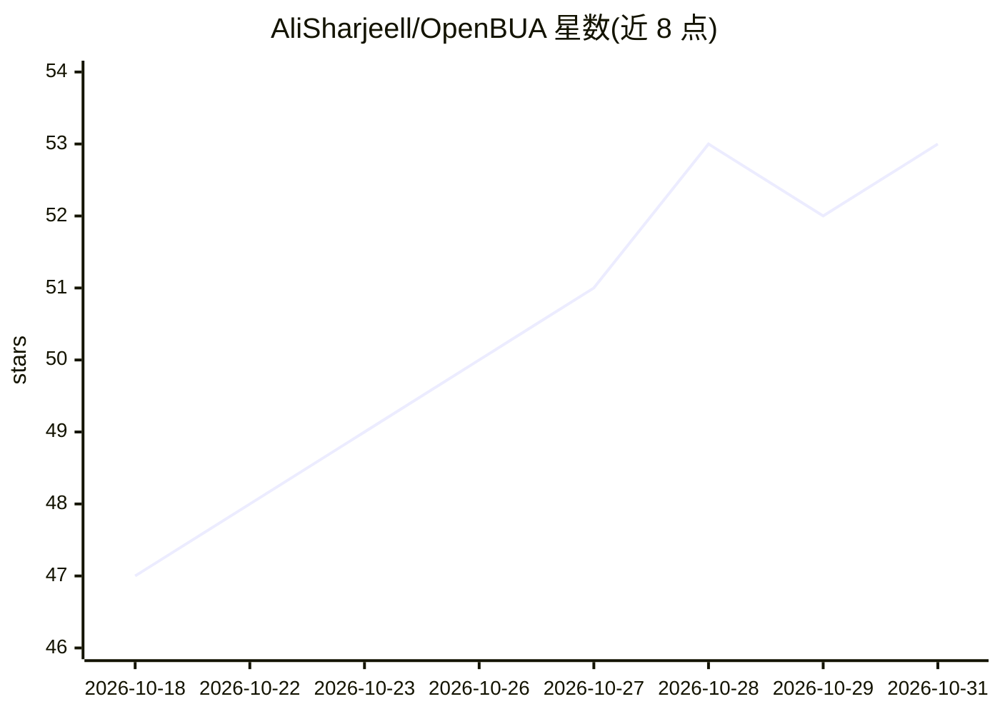

# AliSharjeell/OpenBUA

⭐ 53 · TypeScript · 推送 2026-10-23 · [GitHub](https://github.com/AliSharjeell/OpenBUA) · [官网](www.openbua.com) · 个人维护

**本地运行的 Chrome 自主 AI 浏览器代理扩展**

以 Chrome 扩展（Manifest V3）形式运行的自主 AI 浏览器代理，在用户已登录的浏览器会话内执行任务：多页网页研究与线索整理、结构化表格的实时预览流式输出、基于已存储资料的表单/求职门户自动填写、Gmail/Outlook 邮件代发、跨 12 个平台的一键社媒发帖、多标签页与多窗口并行编排、人机协作式 CAPTCHA 处理，以及双层（Global/Tab）自我学习记忆与文档上传。默认提供 Gemini 免费模式，也支持 BYOK 接入 OpenAI/Anthropic/Groq/OpenRouter/DeepSeek/Ollama 等。完全客户端执行，无后端服务器；安装方式为下载 Releases 预构建 zip 并以开发者模式加载。

## 筛选速览

| 维度 | 判定 | 备注 |
|---|---|---|
| AI 角色 | `ai-native` | 本体是模型或模型工具 |
| 许可风险 | `none` | — |
| 部署形态 | `desktop` | 安装包/桌面程序 |
| 模型依赖 | local-ok | 支持本地模型 |
| 硬件要求 | — | 无带数字的原话,不猜 |
| 安装摩擦 | `low` | 无编译、无系统依赖或容器化 |
| 成熟度 | — | 结构信号不足 |

## 能力要点

- 复用浏览器既有登录会话执行研究与外联任务，无需重新认证
- Live Research Preview 边抓取边流式写入结构化 Markdown 表格
- 合成事件链表单填写，兼容 React/Vue/Angular/Svelte 表单并回验 DOM 值
- Global/Tab 双层自我学习记忆与 Suggested Memories 审批界面
- BYOK 多提供商接入，另含每日 1,500 请求的 Gemini 免费档

## 适用场景

- 让 agent 用我已登录的 LinkedIn/Gmail 做多页资料搜集并发送外联邮件
- 自动填写求职申请门户（Greenhouse/Lever/Workday）的长表单
- 一次调用将视频与文案发布到多个社交媒体平台
- 开多个 Chrome 窗口让 agent 并行执行独立任务

## 场景标签

`浏览器自动化` `网页抓取` · 领域:效率与自动化

## 证据(README 行号)

> L9: **OpenBUA** (Open Browser Use Agent) is an open-source, autonomous AI browser agent built as a Chrome Extension (Man
> L11: Built with **`@earendil-works/pi-agent-core`** and **`@earendil-works/pi-ai`**, OpenBUA equips AI models with real-
> L30: Because OpenBUA runs directly in your existing browser, it executes end-to-end autonomous workflows without login b

## 星数曲线

2026-10-18 47 → 2026-10-31 53（+6）

---
*卡片 v1 · prompt 1.4 · 生成 2026-10-25 · 置信度 mid · 依据 README sha `d6a934b61340` · [字段定义](../../DATASET.md)*
