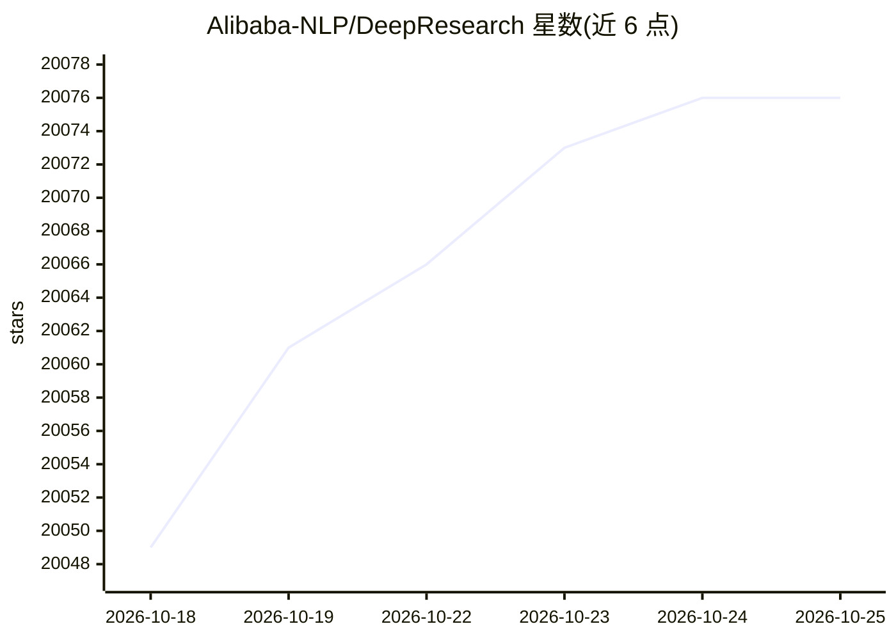

# Alibaba-NLP/DeepResearch

⭐ 20,076 · Python · Apache-2.0 · 推送 2026-02-27 · [GitHub](https://github.com/Alibaba-NLP/DeepResearch) · [官网](https://tongyi-agent.github.io/blog/introducing-tongyi-deep-research/) · 组织维护 · 中文 README

**面向长程深度信息检索任务的 30B 级开源 agent 模型**

通义实验室发布的 agentic 大语言模型，总参数 30.5B、每 token 激活 3.3B，上下文 128K，面向长程深度信息检索任务。训练机制包括全自动合成数据管线、基于 GRPO 定制框架的端到端强化学习；推理兼容 ReAct 与基于 IterResearch 的 Heavy 测试时扩展两种范式。提供 HuggingFace/ModelScope 权重下载、本地推理评测脚本，并可通过 OpenRouter API 无 GPU 调用；官方在线 demo 仅用于快速探索，稳定体验建议本地部署。

## 筛选速览

| 维度 | 判定 | 备注 |
|---|---|---|
| AI 角色 | `ai-native` | 本体是模型或模型工具 |
| 许可风险 | `permissive` | Apache-2.0 |
| 部署形态 | `library` | 以包/库形式分发 |
| 模型依赖 | locked-api |  |
| 硬件要求 | — | 无带数字的原话,不猜 |
| 安装摩擦 | `low` | 无编译、无系统依赖或容器化 |
| 成熟度 | — | 结构信号不足 |

## 动量与使用信号

- 维护:`declining` — 距上次 push 232.8 天,年发版 0,27 位贡献者
- 涨星:近 1 天 **-2**(自 20261016 起算)
- 安装:github 包 `release-assets` 月下载无数据
- 平台:— · 协议:OPENAI-API

## 能力要点

- 30.5B 总参数、每 token 激活 3.3B 的 MoE 结构，128K 上下文
- 全自动合成数据管线支持 agentic 预训练、SFT 与强化学习
- 兼容 ReAct 与 IterResearch Heavy 两种推理范式
- 提供 OpenRouter API 通道，无 GPU 也可运行推理

## 适用场景

- 在评测数据集上运行深度信息检索基准评估
- 本地部署 30B-A3B 权重开展 agent 搜索研究
- 通过 OpenRouter API 直接调用模型做问答实验

## 场景标签

`强化学习` `模型评测` `科研工具` · 领域:评测与运维

## 证据(README 行号)

> L20: We present **Tongyi DeepResearch**, an agentic large language model featuring 30.5 billion total parameters, with o
> L31: - 🤖 **Agent Inference Paradigm Compatibility**: At inference, Tongyi DeepResearch is compatible with two inference 
> L154: Tongyi-DeepResearch-30B-A3B is now available at OpenRouter. You can run the inference without any GPUs.

## 星数曲线

2026-10-18 20,049 → 2026-10-25 20,076（+27）

---
*卡片 v1 · prompt 1.4 · 生成 2026-10-18 · 置信度 high · 依据 README sha `66c11d26f7c0` · [字段定义](../../DATASET.md)*
