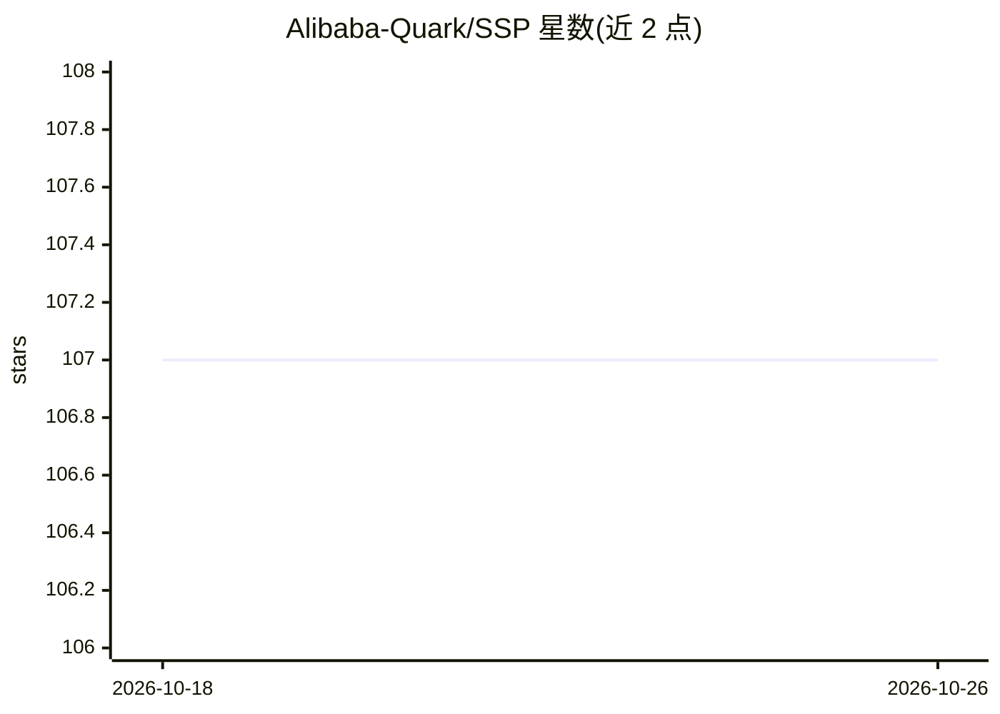

# Alibaba-Quark/SSP

⭐ 107 · Python · Apache-2.0 · 推送 2026-07-23 · [GitHub](https://github.com/Alibaba-Quark/SSP) · [官网](https://arxiv.org/abs/2510.18821) · 组织维护 · 中文 README

**训练带搜索引擎调用能力的对抗自博弈 agent 的 RL 框架**

阿里夸克 LLM 团队开源的强化学习训练框架：设提出者与求解者两个 agent，在多轮推理中均可调用搜索引擎（本地稠密检索服务），基于规则化结果奖励做对抗自博弈共进化，无需人工标注问答对。基于 veRL 与 Search-R1 构建，支持为两个角色分别配置 PPO/GRPO/REINFORCE 等算法，可单机或多机分布式训练。安装需 Conda 环境、克隆源码、安装依赖并自行编译安装 veRL，训练前还需启动 LLM-as-a-Judge 服务与检索服务并准备模型 checkpoint。

## 筛选速览

| 维度 | 判定 | 备注 |
|---|---|---|
| AI 角色 | `ai-ecosystem` | LLM/agent 周边工具 |
| 许可风险 | `permissive` | Apache-2.0 |
| 部署形态 | `library` | 以包/库形式分发 |
| 模型依赖 | — | README 未给出锁定关系 |
| 硬件要求 | — | 无带数字的原话,不猜 |
| 安装摩擦 | `low` | 无编译、无系统依赖或容器化 |
| 成熟度 | — | 结构信号不足 |

## 能力要点

- proposer/solver 双 agent 对抗自博弈，无需标注 QA 对
- 两个角色可分别配置不同 RL 算法（PPO/GRPO/REINFORCE）
- 基于 veRL 与 Search-R1，支持多轮搜索引擎调用
- 支持单机与多节点分布式训练

## 适用场景

- 训练具备搜索与推理能力的 agent 模型
- 研究生成难题与解题相互促进的自博弈训练范式
- 复现论文 2510.18821 的实验结果

## 场景标签

`强化学习` · 领域:训练与推理

## 证据(README 行号)

> L9: **Search Self-Play (SSP)** is a reinforcement learning framework designed for training **adversarial self-play agent
> L13: Built upon veRL and Search-R1, SSP extends the traditional self-play paradigm by incorporating tool-augmented reaso
> L15: Through RL training with rule-based outcome rewards, SSP enables two roles to **co-evolve** in an adversarial compe

## 星数曲线

2026-10-18 107 → 2026-10-26 107（+0）

---
*卡片 v1 · prompt 1.4 · 生成 2026-10-23 · 置信度 mid · 依据 README sha `67b30a4891d7` · [字段定义](../../DATASET.md)*
