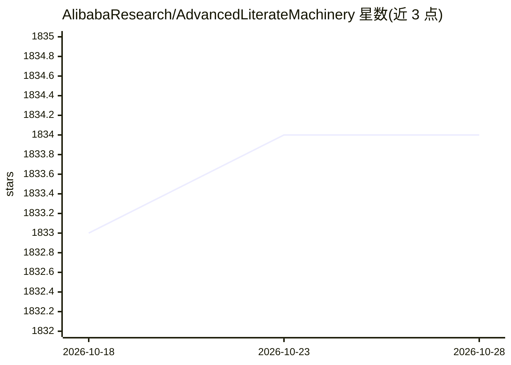

# AlibabaResearch/AdvancedLiterateMachinery

⭐ 1,834 · C++ · Apache-2.0 · 推送 2026-03-17 · [GitHub](https://github.com/AlibabaResearch/AdvancedLiterateMachinery) · 组织维护 · 中文 README

**阿里读光OCR团队的文档智能研究论文与算法集合**

由阿里通义实验室读光 OCR 团队维护的研究成果集合，围绕从图像与文档中读取文字展开，按时间线发布论文、基准与开源组件：涵盖 OCR 基准 CC-OCR（39 子集 7,058 张标注图）、统一文本识别模型 Platypus、场景文字图像生成 SceneVTG、网页渲染参数生成 WebRPG、统一解析框架 OmniParser（文本检测/关键信息抽取/表格识别）及开源文档解析工具链 DocXChain 等。条目多以论文为单位发布，部分附带数据集与模型。README 本身不含安装命令。

## 筛选速览

| 维度 | 判定 | 备注 |
|---|---|---|
| AI 角色 | `ai-knowledge` | 知识聚合/清单类 |
| 许可风险 | `permissive` | Apache-2.0 |
| 部署形态 | `None` |  |
| 模型依赖 | — | README 未给出锁定关系 |
| 硬件要求 | — | 无带数字的原话,不猜 |
| 安装摩擦 | `low` | 无编译、无系统依赖或容器化 |
| 成熟度 | — | 结构信号不足 |

## 能力要点

- 汇集 2022-2024 年多篇会议论文（ECCV/CVPR/ICCV/AAAI/EMNLP 等）
- CC-OCR 基准：4 条 OCR 赛道、39 子集、7,058 张全标注图像
- DocXChain 开源工具链：文本检测识别、表格结构、版面分析及 PDF 转 JSON
- OmniParser 统一框架同时处理文本 spotting、信息抽取与表格识别

## 适用场景

- 查找 OCR 与文档理解方向的论文、基准与数据集
- 基于 DocXChain 工具链做文档解析与结构化
- 用 CC-OCR 基准评测大型多模态模型的 OCR 能力

## 场景标签

`OCR` `文档解析` `模型评测` · 领域:评测与运维

## 证据(README 行号)

> L17:  - **CC-OCR** (*CC-OCR: A Comprehensive and Challenging OCR Benchmark for Evaluating Large Multimodal Models in Lit
> L20:  - **Platypus** (*Platypus: A Generalized Specialist Model for Reading Text in Various Forms,* ECCV 2024. paper): P
> L35:  - **DocXChain** (*DocXChain: A Powerful Open-Source Toolchain for Document Parsing and Beyond,* arXiv 2023. report

## 星数曲线

2026-10-18 1,833 → 2026-10-28 1,834（+1）

---
*卡片 v1 · prompt 1.4 · 生成 2026-10-21 · 置信度 mid · 依据 README sha `e087b0889e51` · [字段定义](../../DATASET.md)*
