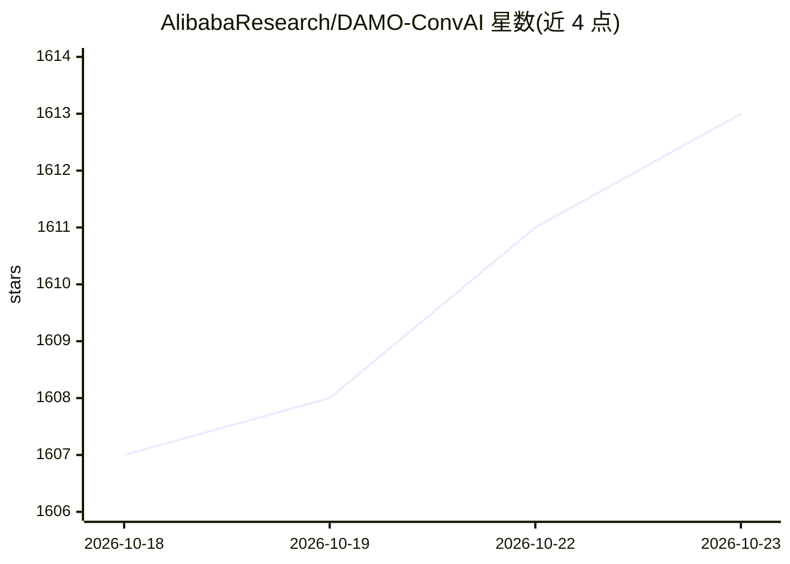

# AlibabaResearch/DAMO-ConvAI

⭐ 1,613 · Python · MIT · 推送 2026-10-19 · [GitHub](https://github.com/AlibabaResearch/DAMO-ConvAI) · 组织维护 · 中文 README

**阿里达摩院对话式 AI 研究代码库（论文与模型成果集合）**

阿里巴巴达摩院对话式 AI 的官方代码库，收录该团队对话系统与自然语言处理方向的系列研究工作代码，对应成果包括 SPACE 系列、R²SQL、S²SQL、BIRD-SQL 等模型，论文发表于 ACL、EMNLP、AAAI、SIGIR、NeurIPS 等会议，并在 Spider、DSTC11-SIMMC 等基准/竞赛中获得名次。以 MIT 许可发布。README 仅含成果列表与许可信息，未给出安装运行说明。

## 筛选速览

| 维度 | 判定 | 备注 |
|---|---|---|
| AI 角色 | `ai-native` | 本体是模型或模型工具 |
| 许可风险 | `permissive` | MIT |
| 部署形态 | `None` |  |
| 模型依赖 | — | README 未给出锁定关系 |
| 硬件要求 | — | 无带数字的原话,不猜 |
| 安装摩擦 | `low` | 无编译、无系统依赖或容器化 |
| 成熟度 | — | 结构信号不足 |

## 能力要点

- SPACE 系列对话模型代码（AAAI 2022/SIGIR 2022 接收）
- R²SQL/S²SQL 曾列 Spider、SparC、CoSQL 榜单第一
- BIRD-SQL 被 NeurIPS 2023 接收为 Spotlight
- 以 MIT 许可开源

## 适用场景

- 复现达摩院对话系统相关论文的模型与实验
- 研究文本到 SQL 与多模态对话方向的参考实现
- 跟踪该团队的论文成果列表

## 场景标签

`多模态` `数据分析` · 领域:效率与自动化

## 证据(README 行号)

> L5: **DAMO ConvAI: The official repository which contains the codebase for Alibaba DAMO Conversational AI.**
> L15: - [**2024-02**]: 5 papers are accepted by LREC-COLING 2024 ！

## 星数曲线

2026-10-18 1,607 → 2026-10-23 1,613（+6）

---
*卡片 v1 · prompt 1.4 · 生成 2026-10-21 · 置信度 low · 依据 README sha `a5155190b5ff` · [字段定义](../../DATASET.md)*
