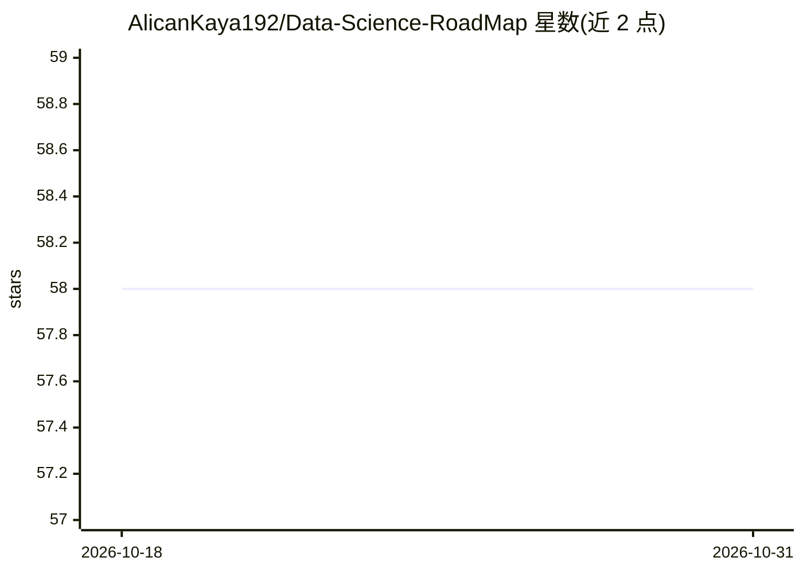

# AlicanKaya192/Data-Science-RoadMap

⭐ 58 · Jupyter Notebook · MIT · 推送 2026-09-14 · [GitHub](https://github.com/AlicanKaya192/Data-Science-RoadMap) · [官网](https://alican-kaya.com) · 个人维护

**给数据科学学习者的 23 模块端到端学习路线图**

从 Python 基础到生成式 AI、强化学习与 API 开发的 23 模块结构化学习资源：每个主题配带运行输出的 Jupyter Notebook、100+ PDF 理论文档与 50+ 实践项目。内容覆盖 NumPy/Pandas、EDA、CRM 分析（RFM/CLTV）、推荐系统、特征工程、机器学习、SQL、时间序列、Docker、NLP、生成式 AI（LangChain/RAG/微调）、Q-Learning/DQN 与 FastAPI。依赖经 requirements.txt（拆分为 core/nlp/genai 三个子文件）安装，部分生成式 AI 模块需 API key。附速查表、面试题与独立桌面版项目 Odyssey。

## 筛选速览

| 维度 | 判定 | 备注 |
|---|---|---|
| AI 角色 | `ai-knowledge` | 知识聚合/清单类 |
| 许可风险 | `permissive` | MIT |
| 部署形态 | `library` | 以包/库形式分发 |
| 模型依赖 | — | README 未给出锁定关系 |
| 硬件要求 | — | 无带数字的原话,不猜 |
| 安装摩擦 | `low` | 无编译、无系统依赖或容器化 |
| 成熟度 | — | 结构信号不足 |

## 能力要点

- 23 个按学习顺序编号的模块，附各模块独立 README
- 50+ 实践项目与 100+ PDF 理论文档
- 依赖拆分为 core/nlp/genai 三个 requirements 文件按需安装
- 附 21 个 Python 练习项目、CheatSheets 与面试题

## 适用场景

- 按顺序系统学习从 Python 到机器学习的完整路径
- 用真实数据集练习 CRM 分析、推荐系统与时间序列预测
- 学习生成式 AI 模块的 LangChain、RAG 与微调内容
- 准备数据科学技术面试并查阅速查表

## 场景标签

`教程课程` · 领域:学习与行业

## 证据(README 行号)

> L73: Bu repository, Python programlama dili öğrenim sürecimde oluşturduğum notları, örnek kodları ve projeleri içeren ka
> L22: |📦 **23 Modül**|Temel Python'dan Generative AI, Reinforcement Learning ve API Geliştirmeye kadar uçtan uca müfredat

## 星数曲线

2026-10-18 58 → 2026-10-31 58（+0）

---
*卡片 v1 · prompt 1.4 · 生成 2026-10-24 · 置信度 high · 依据 README sha `21d37ed0e518` · [字段定义](../../DATASET.md)*
