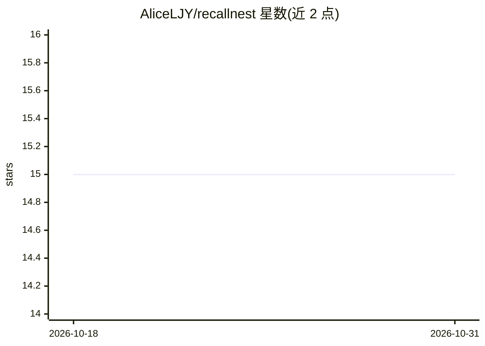

# AliceLJY/recallnest

⭐ 15 · TypeScript · MIT · 推送 2026-10-27 · [GitHub](https://github.com/AliceLJY/recallnest) · [官网](https://aliceljy.github.io/recallnest/) · 个人维护 · 中文 README

**给各类 AI 客户端共享的本地长期记忆层**

基于 LanceDB 的本地优先共享记忆系统：通过 MCP(stdio) 与 HTTP API 两种通道，让 Claude Code、Codex、Kimi、Antigravity 等编码 agent 读写同一份记忆库。提供 6 通道混合检索（向量+BM25+多层折叠+知识图谱，默认仅向量）、会话 checkpoint/resume、三层会话蒸馏、记忆衰减与演进、4 级隐私分层、写入门控与记忆 lint。图像仅存可寻址引用不入库；HTTP API 默认仅绑 127.0.0.1，跨机经 SSH 或只读网关共享。以 Claude Code 插件或 npm/源码方式安装。

## 筛选速览

| 维度 | 判定 | 备注 |
|---|---|---|
| AI 角色 | `ai-ecosystem` | LLM/agent 周边工具 |
| 许可风险 | `permissive` | MIT |
| 部署形态 | `library` | 以包/库形式分发 |
| 模型依赖 | locked-api |  |
| 硬件要求 | — | 无带数字的原话,不猜 |
| 安装摩擦 | `low` | 无编译、无系统依赖或容器化 |
| 成熟度 | — | 结构信号不足 |

## 能力要点

- 单份 LanceDB 存储被多个终端/机器上的 MCP 客户端共享读写
- 6 通道混合检索（向量/BM25/L0-L2 多向量/知识图谱 PPR），默认向量模式
- 记忆生命周期管理：Weibull 衰减、证据晋升、矛盾/重复检测、离线整理(dream)
- 4 级隐私分层与级联遗忘；图像只存可寻址引用，不产生模型调用与向量存储

## 适用场景

- 让多个编码 agent 跨窗口、跨机器共享同一份项目记忆
- 会话退出时 checkpoint、重启时恢复上下文
- 手机端 AI 应用经只读网关查询同一记忆库
- 从 Claude Code/ChatGPT/Slack 等导入历史对话并索引

## 场景标签

`Agent 记忆` · 领域:Agent 开发

## 证据(README 行号)

> L3: **Shared Memory Layer for Every AI Client — CLI agents, desktop apps, your own scripts**
> L64: |**Shared Index**|One LanceDB store shared by every terminal that speaks MCP|
> L146: |Run a local command (CLI agent)|**MCP over stdio**|Claude Code, Codex, Kimi, Antigravity|

## 星数曲线

2026-10-18 15 → 2026-10-31 15（+0）

---
*卡片 v1 · prompt 1.4 · 生成 2026-10-31 · 置信度 high · 依据 README sha `eedf8761cf82` · [字段定义](../../DATASET.md)*
