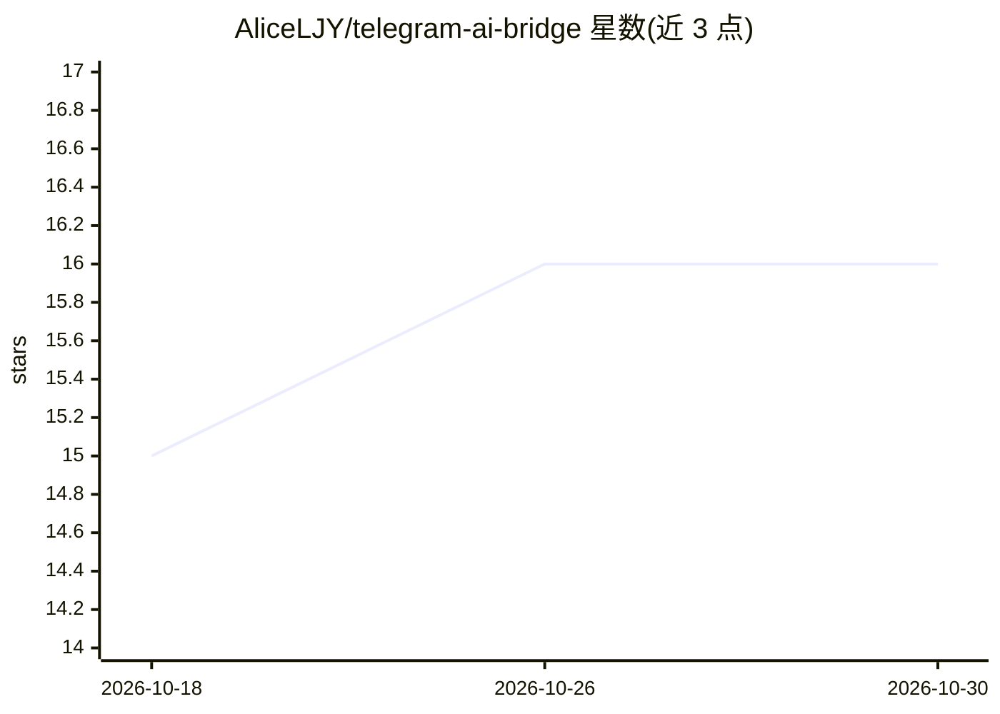

# AliceLJY/telegram-ai-bridge

⭐ 16 · JavaScript · MIT · 推送 2026-10-14 · [GitHub](https://github.com/AliceLJY/telegram-ai-bridge) · 个人维护 · 中文 README

**让多后端 AI agent 在 Telegram 群里协作的自托管桥接网关**

把 Claude Code、Codex、Antigravity CLI、Kimi Code 等后端 CLI/SDK 接入 Telegram 的自托管桥接层：单 bot 手机控制、多实例并行会话共享记忆（War Room 模式）、异构 agent 群聊自动对话（A2A-TG 模式），并内置代数计数环路抑制、限流、重试与优雅关停。适配器边界开放，可添加其他带 CLI/SDK 的 agent。运行需 Bun 运行时与 Telegram bot token，v5 仅支持 git clone 源码安装，npm 包为旧 v3.1.0 快照且非支持渠道。

## 筛选速览

| 维度 | 判定 | 备注 |
|---|---|---|
| AI 角色 | `ai-ecosystem` | LLM/agent 周边工具 |
| 许可风险 | `permissive` | MIT |
| 部署形态 | `self-host` | docker 或自建部署 |
| 模型依赖 | locked-api |  |
| 硬件要求 | — | 无带数字的原话,不猜 |
| 安装摩擦 | `low` | 无编译、无系统依赖或容器化 |
| 成熟度 | — | 结构信号不足 |

## 能力要点

- A2A-TG 信封协议 + 5 层环路抑制，实现异构 agent 群聊协作且不失控
- 多实例并行会话共享记忆（CLAUDE.md / MCP / ~/.claude），SQLite 默认、Redis 可选
- 4 种后端（claude/codex/agy/kimi）经适配器接入，可扩展其他 CLI/SDK agent
- 发送重试、滑动窗口限流、FlushGate 批量、流式预览与优雅关停等可靠性机制

## 适用场景

- 在手机 Telegram 上控制和恢复桌面端的多个 Claude Code 会话
- 把多个 AI agent 放进同一个群协作审阅代码或辩论方案
- 自托管一个常驻的 Telegram-agent 网关，按 owner 白名单触发

## 场景标签

`多智能体` · 领域:Agent 开发

## 证据(README 行号)

> L5: *Claude Code, Codex, Agy, and Kimi as independent full-stack bots, coordinated over a Telegram-native envelope proto
> L7: Those four are the adapters bundled and tested here, not a closed provider list. Telegram routing, sessions, streami
> L123: **Prerequisites:** Bun runtime, a Telegram bot token (from @BotFather), and at least one backend CLI: Claude Code,

## 星数曲线

2026-10-18 15 → 2026-10-30 16（+1）

---
*卡片 v1 · prompt 1.4 · 生成 2026-10-30 · 置信度 mid · 依据 README sha `ed08e1c474a6` · [字段定义](../../DATASET.md)*
